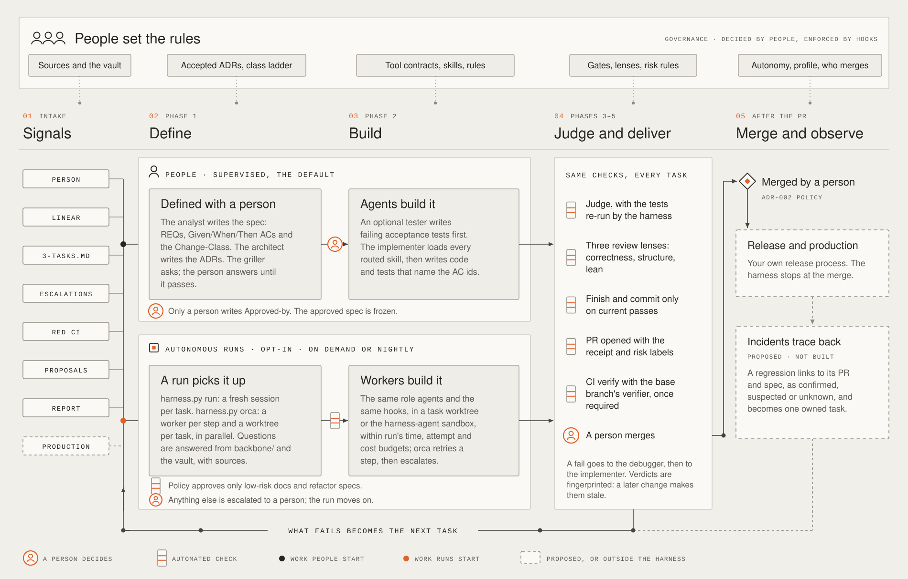
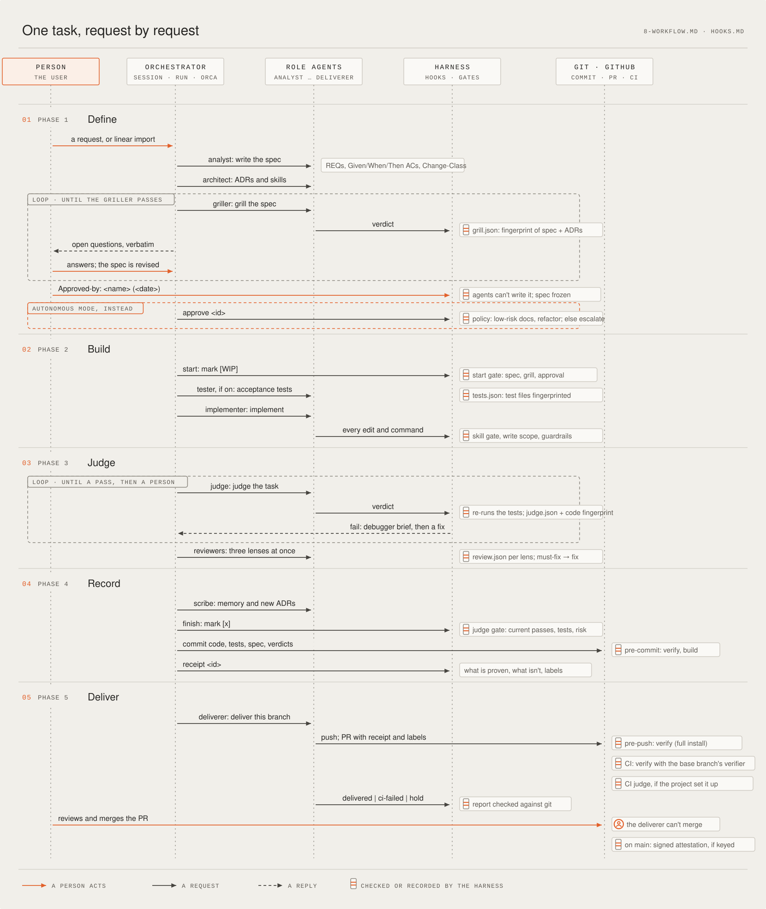
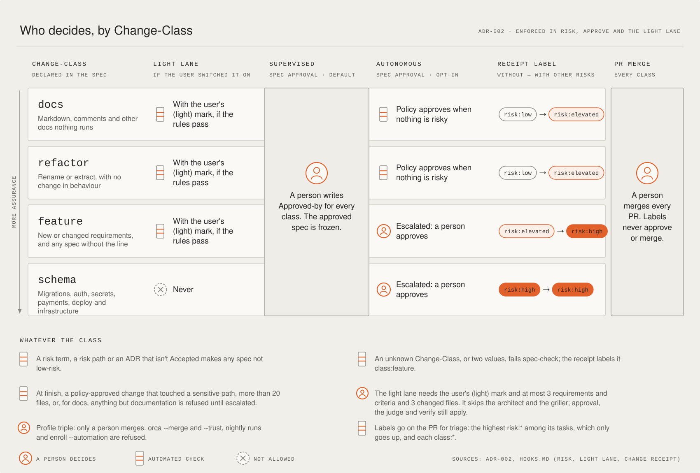
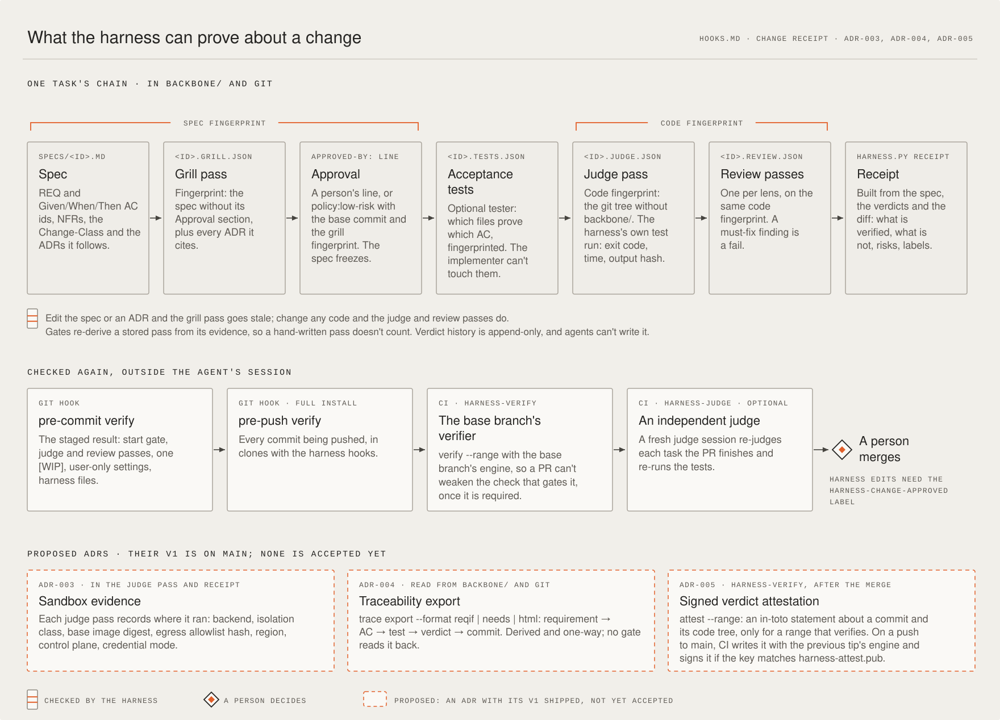

# Agentic Harness

A stack-agnostic harness for AI coding agents such as Claude Code, Codex and OpenCode. Install it into any git
repository and every change goes through **one defined, gated pipeline**, whoever or whatever starts it, while people
set the rules. The four diagrams below are explained in [docs/sdlc](docs/sdlc/README.md). Solid shapes are built and
enforced; dashed ones are proposed or outside the harness; the orange person marks each point where the harness waits
for a human.

The harness never generates application code. On the first session, the agent interviews you to fill in the project's
knowledge, stack ADR, language skill and routes. Requirements: `git` and `python3` (3.8 or later, standard library
only).

## The factory



- **People set the rules.** Only the user accepts an ADR, writes the tool contracts in `tools.conf`, or changes the
  user-only keys of `harness.conf`: the gate switches, risk rules, autonomy mode and profile. Hooks refuse agents'
  edits to them, and verify refuses commits that change the user-only settings or contracts. Skill routes and
  guardrails come from the packs an accepted ADR adopts and the rules agreed at setup.
- **Signals.** Work starts from a person, a Linear ticket (`harness.py linear import`) or the task list. The harness's
  own feedback adds more: escalations, red CI, failure-class proposals and `harness.py report` candidates. Production
  incidents are not a signal yet.
- **Two lanes, one standard.** In a supervised session (the default) a person answers the griller and signs
  `Approved-by`. In an autonomous run (`harness.py run`, `harness.py orca`), questions are answered from `backbone/`
  and the knowledge vault, with sources; policy approves only low-risk `docs` and `refactor` specs, and everything else
  is escalated to a person.
- **Same checks, every task.** Whichever lane a task came from, it passes the judge (the harness re-runs the tests
  itself), the three review lenses, the judge gate at finish, verify on every commit, and `harness-verify` in CI with
  the base branch's verifier. Then a person merges the pull request (ADR-002): the deliverer can't merge, and under
  the `triple` profile no agent can. `harness-verify` blocks a merge only once it is a required check in branch
  protection (`harness.py ci-protect` or `enroll.sh --protect`).
- **What fails becomes the next task.** Red CI becomes a fix task on the same pull request, escalations wait for a
  person, a failure class seen twice opens a proposal, and the report points at missing rules or skills. Tracing a
  production incident back to its pull request and spec is proposed in
  [ADR-007](docs/adr/ADR-007-evidence-closed-loop.md), not built.

## One task, request by request



- **Definition first**: one spec per task (`backbone/specs/<id>.md`) holds numbered requirements, Given/When/Then
  acceptance criteria, NFRs, the `Change-Class`, the ADRs it follows and the skills it needs. A PRD is optional; ADRs
  are mandatory.
- **Grilling**: an adversarial `griller` agent questions the spec and its ADRs. Its questions go to the user, the spec
  is revised, and grilling repeats until it passes. Then the **user** approves the spec. Only the user can write the
  approval line, and an approved spec is frozen. For small fixes, the user can switch on a **light lane** and mark a
  task `(light)`: a small, low-risk spec then skips the architect and the griller, while the approval, the judge and
  verify still apply.
- **Skill routing**: `routing.conf` maps paths to skills. ADRs need `adr-writing`, `architecture` and the language
  skill; controllers need `api-design` and `openapi`; and so on. The spec adds what the task needs. An agent can't edit
  a file until it has loaded every required skill in its session.
- **Tool contracts**: every tool that can change something goes through the gate. A user-owned `backbone/tools.conf`
  says what each MCP or other tool does (read, write with its path field, exec, network, agent, and whether it needs
  the user); a write tool's paths get the same gates as Write and Edit. In supervised mode a tool with no contract runs
  with a warning; in autonomous mode it is refused.
- **Guardrails** throughout: destructive commands, secrets and project rules are blocked. Each agent can only write
  its own files, and the main session only orchestrates. Shell commands can't write harness state or switch off
  checks, and a script that does is caught: reported in supervised mode, escalated in autonomous mode. One task is
  `[WIP]` at a time. Commits follow Conventional Commits. The gates are on by default and only the user can switch them
  off.
- **Judging**: an independent `judge` checks every requirement and acceptance criterion against the code and tests.
  The verdict is recorded by a hook, which re-derives it from the evidence: an AC without a test that mentions its id,
  unmet criteria or failing tests all turn a claimed pass into a fail. The recorder runs the test command itself rather
  than trusting the judge's report. After a fail, the `debugger` writes a fix brief for whoever owns the cause.
- **Review and delivery**: after the judge, three `reviewer`s check the change in parallel, one lens each: correctness
  (bugs, security, blast radius proven by running code), structure and lean. A must-fix finding sends the task back to
  the implementer. Once the task is committed, the `deliverer` pushes the branch, opens the PR with each task's receipt
  and labels, and watches CI. It runs only the gh commands delivery needs, against this repository only; it can't
  merge, approve or close, and its git ref commands (checkout, merge, reset, push and the like) may not name the default
  branch, which changes only through the PR. Finishing, committing and pushing (pre-push hook) all refuse a task
  without its review passes. Both are on by default (`HARNESS_REVIEW`, `HARNESS_DELIVER`, user-only).
  `HARNESS_DELIVER="external"` is for a lane without GitHub credentials: the task stops at the deliver step,
  `delivery-plan` tells an agent factory what to push and open from its trusted clone, and `delivery-record` records
  the outcome.

## Who decides, by Change-Class



- **The ladder** ([ADR-002](docs/adr/ADR-002-change-class-ladder.md)). The spec declares its `Change-Class`: `docs`,
  `refactor`, `feature` or `schema`; a spec without the line counts as `feature`. The class changes three things:
  whether the light lane applies, whether autonomous mode may approve the spec by policy, and which risk label the
  receipt suggests: `risk:low` (`docs`, `refactor`), `risk:elevated` (`feature`, or `docs`/`refactor` with other risks)
  or `risk:high` (`schema`, or `feature` with other risks). Whatever the class, a person approves every spec in
  supervised mode and merges the pull request.
- **Autonomous mode** (opt-in, user-only): no human in the loop. The harness approves low-risk specs by policy, from
  the spec and later the diff; only a `docs` or `refactor` spec can be low-risk, so `feature` and `schema` work always
  waits for the user's approval. Everything else, including repeated griller or judge failures, is escalated: the task
  is parked as BLOCKED, an entry goes into `backbone/escalations.md` (optionally a GitHub issue), and work continues. A
  kill switch halts everything.

## What the harness can prove



The receipt is built from evidence, not from what the agents said. Two fingerprints tie each verdict to what it judged
(the spec and its ADRs for the grill pass, the code tree for the judge and review passes), so a later edit makes the
pass stale.

- **Change receipt**: `harness.py receipt <id>` states what the harness can prove about a judged task: what changed,
  each acceptance criterion with its tests, what is *not* verified, the decisions and risks, and what still needs the
  user. It is built from the spec, the verdicts and the diff, and goes into the pull requests the runner and the Orca
  coordinator open. It shows the sandbox the judge pass was recorded in (backend, isolation class, base image digest,
  allowlist hash, region, control plane, credential mode; [ADR-003](docs/adr/ADR-003-sandbox-backends.md), Proposed),
  so a run that wasn't isolated shows it. It also suggests pull request labels for triage: one `risk:*` label and
  `class:<class>`. The deliverer applies them; a label never approves or merges.
- **Verify**: the pre-commit hook re-checks the gates on the staged state, the pre-push hook (full installs) the
  commits being pushed, and CI the pull request's commits (`harness.py verify --range`) with the **base branch's**
  verifier, so a pull request can't weaken the check that gates it, and a change made any other way is still caught.
- **Traceability export** ([ADR-004](docs/adr/ADR-004-traceability-export.md), Proposed): `harness.py trace export
  --format reqif|needs|html [--out DIR] [--task ID]` writes the chain requirement → acceptance criterion → test file →
  judge verdict → commit as ReqIF 1.2, a Sphinx-Needs `needs.json` (format 1) or a self-contained HTML matrix for a pull
  request. It is derived from `backbone/` and git, which stay the record: one-way, no network, nothing reads it back.
  Each task says whether its judge pass is on the current code, which commits carry the judged code, and the gaps it can
  see. It is not signed, validated or PCI DSS evidence; the ADR lists what it can and can't support.
- **Signed verdict attestations** (optional, [ADR-005](docs/adr/ADR-005-verdict-attestations.md), Proposed):
  `harness.py attest --range <base>..<tip>` prints an in-toto Statement about the tip commit with each finished task's
  verdict chain (spec fingerprint, grill, judge and review verdicts, Change-Class, risk and receipt), only for a range
  that passes `verify --range`, and the same bytes for the same commits. On each push to the default branch, the
  `attest` job of `harness-verify` writes it with the engine the push starts from (the previous tip, never the pushed
  one) and signs it with cosign, without a transparency log, when the `harness-attest` environment holds the key
  (`HARNESS_ATTEST_KEY`, `HARNESS_ATTEST_PASSWORD`). The key must match the public key committed as
  `harness-attest.pub`, an enforcement file like the harness's own. `harness.py ci-protect --attest` sets up the
  environment, restricted to the default branch. Pull requests never see the key, and the statement claims no SLSA
  level. Details and limits in `backbone/HOOKS.md`.
- **What binds whom**: the hooks and gates bind agents. The user can still switch a gate off in `harness.conf` or
  commit with `HARNESS_VERIFY=off`; CI's `harness-verify` is what binds everyone, once it is required.
- **Safe updates**: harness files are tracked by hash. Local edits are detected and never overwritten silently.

## Driving it

- **Agent CLIs**: the same gates for Claude Code, Codex and OpenCode. Each CLI's hooks (`.claude/settings.json`,
  `.codex/hooks.json`, `.opencode/plugins/harness.js`) call one normalising entry point, and the Codex and OpenCode role
  agents are generated from the Claude Code ones.
- **Orca coordinator** (`harness.py orca`): drives tasks in parallel with Orca supervised workers, one per step and one
  worktree per task. Questions between agents are answered from the sources into the spec, and the agent can differ per
  role.
- **Coordinator API**: `state`, `next`, `questions`, `start` and `finish` let a coordinator (Orca, a script) drive
  tasks without knowing the workflow. `contract --json` states the versioned contract an outside runner (the agent
  software factory of ADR-008) relies on: those answers' JSON fields and the event kinds, each event carrying `v`.
  `intake <request.json>` turns a request from the factory's doors into a task, with its provenance in a frozen
  `## Source` section; an untrusted sender's task waits for a person.
- **Knowledge source** (opt-in, user-only): in autonomous mode, griller questions `backbone/` can't answer are looked up
  in a read-only notes vault behind an MCP server (`knowledge`). Clear answers are recorded with a `vault:<path>`
  citation the harness checks; the rest are escalated.
- **Runner**: `harness.py run` drives ready tasks unattended (optionally one worktree, branch and PR per task, with a
  cost budget), one fresh agent session per task, with time and attempt budgets, escalating stalls. Sessions start
  through a sandbox backend (`HARNESS_SANDBOX_BACKEND`); the only one, `devcontainer`, runs them where the runner runs,
  ideally inside `.devcontainer/harness-agent/`, whose outbound allowlist is enforced from a second container.
- **Observability**: `harness.py report` summarises the event log, and `harness.py trace <id>` shows one task's
  history: the context and skills its agents loaded, the files they edited, what the hooks refused, test runs and
  verdicts.

## Documentation

| Where | What |
|---|---|
| [docs/sdlc](docs/sdlc/README.md) | The four diagrams above, with how to read them |
| `payload/owned/backbone/HOOKS.md` | Every hook, gate and setting, in full; installed as `backbone/HOOKS.md` |
| `payload/owned/backbone/8-WORKFLOW.md`, `payload/owned/AGENTS.md` | The orchestration loop, the Definition of Done and the rules every agent follows |
| [ADR-001](docs/adr/ADR-001-thin-mode-plugin.md) (Accepted) | Thin mode: the engine as an agent plugin, the project keeps its state and a version pin |
| [ADR-002](docs/adr/ADR-002-change-class-ladder.md) (Accepted) | The Change-Class ladder, and PR merge stays human |
| [ADR-003](docs/adr/ADR-003-sandbox-backends.md) (Proposed) | Sandbox backends and the sandbox evidence in the receipt |
| [ADR-004](docs/adr/ADR-004-traceability-export.md) (Proposed) | Traceability export: ReqIF, `needs.json` and an HTML matrix |
| [ADR-005](docs/adr/ADR-005-verdict-attestations.md) (Proposed) | Signed verdict attestations in CI |
| [ADR-006](docs/adr/ADR-006-external-agent-resource-admission.md) (Proposed) | Admit third-party agent setup resources explicitly |
| [ADR-007](docs/adr/ADR-007-evidence-closed-loop.md) (Proposed) | The evidence-driven closed loop: triage, requirement-change impact, incident attribution |
| [Agent-SDLC landscape](docs/research/2026-11-agent-sdlc-landscape.md) | Research: compliance and traceability tools, agent sandboxes; where ADR-003 to ADR-005 came from |
| [Orca self-rollout plan](docs/research/2026-11-orca-self-rollout-plan.md) (Accepted) | Run the open plans and ADR follow-ups on this repository through Orca |
| Proposed plans in [docs/research](docs/research/) | Not accepted or implemented: [design challenge and onboarding](docs/research/2026-11-design-challenge-agent-onboarding-plan.md), [delegation contracts](docs/research/2026-11-delegation-contracts-qualification-plan.md), [task dependency gate](docs/research/2026-11-task-dependency-gate-plan.md), [reviewer-first PR bodies](docs/research/2026-11-pr-body-reviewer-opener-plan.md), [indeterminate side-effect outcome](docs/research/2026-11-indeterminate-side-effect-outcome-plan.md), [model-change instruction review](docs/research/2026-11-model-change-instruction-review-plan.md), [structural skeleton in the spec](docs/research/2026-11-structural-skeleton-spec-plan.md) (parked) |
| [CHANGELOG.md](CHANGELOG.md) | What each release changed |

## Stack-neutral by design

The harness assumes no language, framework or tool. The stack is decided in the **design phase**: the architect records it in an ADR, and you accept it. Only then does the project adopt matching packs from the catalog, which ships with every install but stays inert:

```sh
python3 scripts/harness/lib/harness.py catalog          # packs, when each applies, options the ADR must decide
python3 scripts/harness/lib/harness.py adopt java,quarkus --adr ADR-002 \
        --with gradle,junit5-assertj,no-lombok,no-spring,hexagonal-layers,named-use-cases
python3 scripts/harness/lib/harness.py adopt --remove quarkus     # when a later ADR changes the stack
```

Adoption refuses unless:
- the ADR is Accepted and names the pack;
- every option of the pack is decided.

It then installs the pack's skills, writes its routes and guardrails into the project's `routing.conf` and `guardrails.conf` as blocks citing the ADR, and sets related `harness.conf` values such as the build and test commands.

| Pack | Applies when the ADR chooses | Options to decide |
|---|---|---|
| `java` | Java | build tool `gradle` / `maven`; `junit5-assertj`; `no-lombok` |
| `quarkus` (requires java) | Quarkus | `no-spring`; `hexagonal-layers`; `named-use-cases` |
| `jdbi` (requires java) | JDBI for data access | `no-orm`; `hexagonal-layers`; `flyway` |
| `container` | Container images | engine `podman` / `docker` |
| `typescript` | TypeScript on Node.js | package manager `npm` / `pnpm`; test runner `vitest` / `jest`; `strict` |
| `react` (requires typescript) | React for the UI | `nextjs` (App Router); `testing-library` |
| `triple` | Triple's delivery policy (with `HARNESS_PROFILE=triple`) | `disputes-pci`; `ears` |

Stacks without a pack get project skills written during design, routed in `backbone/routing.conf`.

## Install into a project

```sh
./bootstrap.sh /path/to/repo [--name my-service] [--git-init] [--dry-run]
cd /path/to/repo && git add -A && git commit -m "chore: adopt agentic harness"
```

Then start an agent session in that repo. It reports **SETUP INCOMPLETE** and runs first-run setup with you (`AGENTS.md` section 1).

To keep the engine out of the project instead, install it in [thin mode](#thin-mode).

After a fresh clone, each developer runs this once to activate the git hooks:

```sh
git config core.hooksPath scripts/harness/git-hooks
```

## Update a project

```sh
./update.sh status /path/to/repo           # what is outdated or edited locally
./update.sh /path/to/repo [--dry-run]      # apply
./update.sh /path/to/repo --force          # also replace locally edited harness files (keeps *.harness-bak)
```

| Situation | Result |
|---|---|
| Harness file unchanged locally | Replaced with the new version |
| Edited locally, no upstream change | Kept |
| Edited locally and changed upstream | Kept; new version written to `<file>.harness-new` (exit code 1) |
| Removed from the harness | Deleted if unedited, otherwise left in place |
| Project file (`seed`) | Never rewritten; missing ones are created. New `harness.conf` settings are appended commented out, with their explanation, so nothing changes until you uncomment one |
| `.claude/settings.json` | Harness hook entries replaced; everything else kept |

To switch a project between this full install and thin mode, see [Thin mode](#thin-mode).

## Thin mode

In thin mode the engine isn't copied into the project: an agent plugin, installed once per machine, runs the release
the project pins ([ADR-001](docs/adr/ADR-001-thin-mode-plugin.md)). The project keeps `backbone/` (its state, with the
pin in `backbone/.harness-lock.json`: `"mode": "thin"`, `"version"`, `"commit"`), `CLAUDE.md`, its own and adopted
skills, `.github/workflows/harness-verify.yml`, a pre-commit shim in `.githooks/` and the plugin entries in
`.claude/settings.json`. `scripts/harness/`, `AGENTS.md`, the core agents and skills, `.codex/` and `.opencode/` come
from the plugin and the pinned release. Thin mode needs a release that has it (0.30.0 or later).

**Install the plugin** for each agent CLI you use, at the release your projects pin:

- Claude Code: `/plugin marketplace add soyPeter/agentic-harness#v<version>`, then
  `/plugin install agentic-harness@agentic-harness`. A thin project names both in `.claude/settings.json`, so Claude
  Code offers them to teammates.
- Codex: `codex plugin marketplace add soyPeter/agentic-harness --ref v<version>`, then
  `codex plugin add agentic-harness@agentic-harness`. Codex runs the plugin's hooks once you trust them (`/hooks`).
- OpenCode: a global plugin file, `~/.config/opencode/plugins/agentic-harness.js`, containing
  `export { default } from "/path/to/agentic-harness/plugin/opencode.js";`, where the path is a checkout of the
  release.

Codex and OpenCode plugins can't ship agents, so session start installs the pinned release's role agents in the
user's agents folder.

**Start a project** from its repository root, then commit what it writes:

```sh
python3 /path/to/agentic-harness/plugin/launcher.py init --thin [--version 0.30.0] [--name my-service]
```

In Claude Code, `/agentic-harness:init` does the same. It fetches and checks the release, then writes the project seed
(`backbone/`, `CLAUDE.md`), the pin, `harness-verify.yml`, the shim with `core.hooksPath=.githooks`, and the plugin
entries. After a fresh clone, each developer runs `git config core.hooksPath .githooks` once.

**Move the pin** to upgrade: `python3 /path/to/agentic-harness/plugin/launcher.py pin <version>` (the user's command;
agents can't run it). It checks the release, updates the pin and the plugin's marketplace ref, and brings the shim
and `harness-verify.yml` to that release. The upgrade is then one reviewed change.

**Switch an installed project**:

```sh
./update.sh --to-thin /path/to/repo [--version 0.30.0] [--dry-run]   # full install -> thin mode
./update.sh --to-full /path/to/repo [--force] [--dry-run]             # thin mode -> full install
```

- Both need a clean working tree and check everything before they write. If a write fails part way (permissions, a
  full disk), they undo their changes. On a project that is already switched, they change nothing.
- `--to-thin` pins the installed release, or `--version`. It deletes each harness file you haven't edited and keeps
  an edited one as `<file>.harness-bak`. `backbone/`, `CLAUDE.md` and adopted packs' files stay as they are. The pin
  keeps the hashes the full install recorded for the harness's files among them (`"kept"`) and the install date.
  `harness.py adopt` and `adopt --remove` work from these hashes as they do from a full install's, so a pack can be
  adopted again after the pin moved, and removing one deletes the files you haven't edited. Adopting again never
  overwrites an edited pack file: it keeps the edit, and when the release changed that file too, writes the release's
  copy to `<file>.harness-new` and exits 1, as `update.sh` does; an existing `<file>.harness-new` is never written over,
  and `adopt` refuses until you merge it or delete it. Adopting again while such a `<file>.harness-new` is still there
  reports it as pending and exits 1 until it is gone. An edited file that a dropped option leaves behind is kept, and
  adding the option back treats it as an edited pack file. The switch adds the shim,
  `core.hooksPath=.githooks` and the plugin entries, and takes the harness's hooks and the installed release's
  permission rules out of `.claude/settings.json` (a rule of yours that the harness also adds goes with them, and comes
  back with `--to-full`). With `--version`, it fetches the installed release to read those rules, and refuses if it
  can't. If another hook manager owns `core.hooksPath`, it refuses unless `--force-hooks-path`.
- `--to-full` installs the pinned release's files as `update.sh` would, with the kept hashes telling your edits apart,
  including after the pin moved: a file you haven't edited becomes the release's copy; an edited one is kept, and if
  the release changed it too, its copy goes to `<file>.harness-new` (exit code 1), or `--force` replaces it (keeping
  `<file>.harness-bak`). New `harness.conf` settings are appended, commented out. It takes the shim and the plugin
  entries out again. It uses the installer of the checkout you run it from, with the pinned release's files: run it
  from a checkout of that release or a later one.
- Commit the switch. Its pull request needs the `harness-change-approved` label, like any harness change. After
  `--to-full`, the pre-push hook refuses it, so push with `HARNESS_VERIFY=off git push`.

**CI**: `harness-verify` reads the pin from the base branch, fetches that commit of `soyPeter/agentic-harness` and
runs `verify --range` with it. A pull request that moves the pin, or switches modes, is checked by the base branch's
harness, so it can't weaken its own gate. The first thin install, with nothing on the base branch, uses the pull
request's pin.

**Plugin and pin**: the plugin supplies the agents, skills and agent rules, and the pinned release supplies the
gates. When the plugin isn't the pinned release, session start says so. In autonomous mode, `run` and `orca` refuse
to start and every call except reads is refused until they match. `doctor` reports it as an error in autonomous mode
and a warning in supervised mode. Install the plugin at the pinned release, or move the pin.

**Limits**:

- The first session after a pin change needs the network to fetch the release; until then the hooks refuse
  everything except reads.
- In supervised mode, the plugin's agents and skills can drift from the pinned engine: this is reported, not
  prevented.
- Codex and OpenCode agents are per user, so two projects pinned to different releases share one set.
- Codex asks you to trust the plugin's hooks once.
- Teammates without the plugin get no gates in their agent; `harness-verify` still stops the merge once the branch
  is protected.
- The pre-commit shim is the only git hook: Conventional Commits (`commit-msg`) and the pre-push check run in full
  installs only, while CI's `verify --range` applies to both.
- The `.devcontainer/harness-agent/` sandbox for unattended runs comes with the full install only.

## Enforce it everywhere

The harness enforces itself inside each project (agent hooks, git hooks, CI). Three tools make sure every project
has it and every agent loads it:

- **`./enroll.sh <project> [--orca] [--automation daily] [--agents "default=claude judge=codex"] [--protect]`**:
  - installs or updates the harness and runs the doctor;
  - registers the project in Orca;
  - with `--automation <schedule>`, creates one Orca automation per checkout: its precheck, which Orca runs itself, starts `harness.py orca --merge --trust` in its own Orca terminal (`harness.py orca-nightly`), and its agent reports the previous run's digest (`harness.py orca-digest`);
  - sets the agent per role;
  - with `--protect`, requires the CI checks on the GitHub default branch, keeping its existing checks and rules.

  `--dry-run` shows what it would do. Enrolling again is safe.
- **`./machine.sh install [--roots ~/Work/repos] [--mode warn|block] [--plugin]`**: a user-level guard hook for
  Claude Code and Codex on this machine, in their user settings (`~/.claude` and `~/.codex`, or `$CLAUDE_CONFIG_DIR`
  and `$CODEX_HOME` when set). In a git repository under the roots that isn't enrolled (it has neither a full install
  nor a thin pin), it reminds you (warn) or refuses file edits (block) until the repository is enrolled; enrolled
  repositories are left to their own hooks, or the plugin's. Codex runs the new hook only once you trust it in
  `/hooks`, and once more after it changes. `machine.sh status` shows it, and says whether Codex runs it; `machine.sh
  remove` undoes it. Settings that aren't usable count as none: `roots` or `exempt` that aren't lists of absolute folder
  paths, or an `enroll` that isn't one. `status` says which. The
  CLIs load hooks when a session starts, so restart the sessions that are open after `install`, `install --plugin` or
  `remove`: until then they keep the hooks they started with.
  - The agentic-harness plugin gives the same reminder or refusal from its own hooks, with the same settings
    (`~/.agentic-harness/machine.json`). On a machine with the plugin, `--plugin` writes only the settings and takes
    out a guard hook installed earlier, leaving the guard copy for the sessions still open. In a CLI that runs both,
    the guard hook answers and the plugin stays quiet, so nothing is said twice. Codex runs the guard hook only while
    it is trusted as it is now and switched on (Codex's `config.toml`); until then the plugin answers in its place.
    Where the plugin can't tell (it can't read that file, or Codex runs with `--dangerously-bypass-hook-trust`), it
    answers as well: a refusal can come twice, a reminder still comes once per session and repository. An installed
    guard is a copy: run `install` again after updating the harness. Until you do, the plugin doesn't leave the check
    to that copy, and `status` says it is outdated. Where `status` runs from the checkout that installed the copy, it
    names the copy's release and says the plugin checks too wherever its own `guard.py` differs.
  - `machine.sh managed --out DIR` writes the same guard as Claude Code `managed-settings.json` and Codex
    `requirements.toml`, which nobody on the machine can switch off. Review them and install with sudo (see the
    generated INSTALL.md); the tool never writes system files. The plugin reads only the user's settings, so with a
    managed guard don't run `install --plugin` as well, or a call gets both answers.
- **`orca/skills/agentic-harness/SKILL.md`**: the Orca skill for coordinators you run by hand. It says to check for
  the harness, prefer `harness.py orca`, and otherwise follow the gates (`harness.py next` before every step, command
  steps through the harness, answers recorded in the spec with their source, prompts left to the user). Share it with
  `orca skills share`.

The hard floor stays CI: an agent without hooks, or a human with `--no-verify`, still can't merge past
`harness-verify` once the branch is protected.

The guard's limits, which the plugin's check shares: it needs `python3` and `git` on the PATH, and when its own lookup
fails (no git, a broken config) it lets the call through rather than stop every agent on the machine. It checks the
repository of each file a tool writes and, for shell commands, the working directory plus every path and `cd` target
the command names. A shell command that builds a path at run time (a variable, a computed string) can still reach
another repository unseen. In block mode the only shell command it lets run in an unenrolled repository is the
harness's own `enroll.sh`; a thin install (`launcher.py init --thin`) is yours to run in a terminal.

## Profiles

A profile is an organisation policy on top of the gates. Set it in `backbone/harness.conf` (user-only) or when you enroll:

```sh
./enroll.sh /path/to/repo --profile triple      # writes HARNESS_PROFILE="triple"
./enroll.sh /path/to/repo --profile no-merge    # writes HARNESS_PROFILE="no-merge"
```

| Profile | Effect |
|---|---|
| (empty) | The default: no extra policy |
| `triple` | A supervised pilot where only a human merges. `harness.py orca` refuses `--merge` and `--trust` (use `--pr`, which opens pull requests and never merges), `orca-nightly` refuses to start, and `enroll` refuses `--automation` and `--protect` before changing anything. Its catalog pack, `triple`, adds the Linear, EARS and Disputes/PCI layers (see `catalog/triple/README.md`). |
| `no-merge` | The merge refusals of `triple` for any organisation, such as an agent factory's lanes (ADR-008), without Triple's catalog pack. `enroll` refuses `--automation` and allows `--protect`. |

`HARNESS_PROFILE=triple`, `HARNESS_PROFILE=no-merge` or `TRIPLE_MODE=1` in the environment adds the profile to any project. Unlike other keys, the environment can't lift a profile that `harness.conf` sets: `HARNESS_PROFILE=` in a shell leaves it in force. Doctor reports an unknown profile.

## What gets installed

| Path | Owner | Notes |
|---|---|---|
| `AGENTS.md` | harness | Agent instructions: setup, pipeline, protocol, guardrails |
| `CLAUDE.md` | project | `@AGENTS.md` import plus Claude-specific notes |
| `.claude/agents/` | harness | `analyst`, `architect`, `griller`, `tester`, `implementer`, `judge`, `debugger`, `reviewer`, `scribe`, `deliverer`, with scoped hooks |
| `.codex/hooks.json`, `.codex/agents/` | harness | Codex: the harness hooks and the role agents (generated) |
| `.opencode/plugins/harness.js`, `.opencode/agents/` | harness | OpenCode: the adapter plugin and the role agents (generated) |
| `.claude/skills/` | harness + project | Core: `requirements-writing`, `adr-writing`, `architecture`, `api-design`, `openapi`, `code-quality`, `module-testing`, `security`, `changelog`, `change-review`. Adopted pack skills. Yours: anything else |
| `scripts/harness/catalog/` | harness | Stack packs, inert until adopted from an accepted ADR |
| `backbone/0-START-HERE.md`, `8-WORKFLOW.md`, `HOOKS.md`, `SKILLS.md`, `templates/` | harness | Map, pipeline and DoD, hooks and gates, skill format, spec and ADR templates |
| `backbone/1-PRD.md` … `7-CONVENTIONS.md`, `9-AGENT-SKILLS.md`, `adr/ADR-001` | project | Created with `{{FILL: …}}` placeholders |
| `backbone/specs/`, `backbone/adr/` | project | One spec per task; one ADR per decision |
| `backbone/harness.conf`, `guardrails.conf`, `routing.conf` | project | Commands and gate switches; project rules; skill routes |
| `backbone/.verdicts/` | hooks | Griller and judge verdicts per task, with fingerprints (audit trail) |
| `backbone/.harness-lock.json` | harness | Installed version and file hashes |
| `scripts/harness/` | harness | Runtime (`lib/harness.py`), git hooks, core rules and routes, `doctor.sh` |
| `.github/workflows/harness-verify.yml` | harness | CI: `verify --range` with the base branch's verifier on every pull request; on a push to the default branch, the verdict attestation, signed when `HARNESS_ATTEST_KEY` is set |
| `.github/workflows/harness-judge.yml` | project | CI: an independent judge session re-judges tasks a pull request finishes (needs `ANTHROPIC_API_KEY`; add your toolchain) |
| `.devcontainer/harness-agent/` | harness | Sandbox for unattended runs: an outbound allowlist enforced from a second container (the agent's has no NET_ADMIN or NET_RAW), a base image pinned by digest, a trusted workspace, no prompts. Checked in a real container by `tests/test-sandbox-egress.py` (`HARNESS_E2E=1`); the earlier one-container version ran a real task end to end |
| `.claude/settings.json` | shared | Merged: harness hook entries plus a few read-only permissions |

Check the state of a task's definition with `python3 scripts/harness/lib/harness.py spec-check <id>`, and the harness with `scripts/harness/doctor.sh`.

## Repository layout

```
bootstrap.sh, update.sh         entry points (thin wrappers)
tools/installer.py              install, update and status logic
tools/thin.py                   thin mode: init --thin and pin
tools/convert.py                update.sh --to-thin and --to-full
plugin/                         the plugin's launcher, hooks, pre-commit shim, OpenCode adapter and init skill
.claude-plugin/, .codex-plugin/ plugin manifests for Claude Code and Codex, and the marketplace
tools/gen_agents.py             generates the Codex and OpenCode agents from .claude/agents/
tools/enroll.py, enroll.sh      enroll a project (install or update, Orca, automation, CI protection)
tools/machine.py, machine.sh    the machine guard (user level, or managed files to install)
machine/guard.py                the guard's check: its own hook, or run by the plugin's launcher
orca/skills/agentic-harness/    the Orca skill for coordinators
payload/owned/                  harness-owned files, replaced on update
payload/seed/                   project-owned templates, created once
payload/settings.fragment.json  hooks and permissions merged into .claude/settings.json
catalog/<pack>/pack.json        pack metadata: when it applies, requirements, option groups and options
catalog/<pack>/install/         files adopted into the project (skills, scripts)
catalog/<pack>/{guardrails,routing}.conf  base rules; catalog/<pack>/options/<id>/ option-specific files
tests/run-tests.sh              end-to-end self-test in throwaway repos
VERSION, CHANGELOG.md
```

## Developing the harness

- Run `tests/run-tests.sh` after every change. It installs into temporary repos and runs the whole pipeline (define,
  grill, approve, build, judge) plus every hook, rule and update path. Install the test-only tools first
  (`python3 -m pip install -r tests/requirements.txt`, in a virtual environment). The `tests/test-*.py` files run in
  parallel, `HARNESS_TEST_JOBS` at a time (default: one per CPU). `HARNESS_STRESS=1` adds a stress check of the
  harness-verify step that takes the base branch's engine: it keeps every CPU busy for a few minutes, as on a loaded
  macOS runner.
- The property checks run every example by default (`HYPOTHESIS_PROFILE=thorough`). The required pull request jobs use
  `HYPOTHESIS_PROFILE=ci`, which runs a quarter of the examples for checks that start a process per example; the
  `nightly` workflow runs the full profile on Ubuntu and macOS every night.
- Bump `VERSION` and add a `CHANGELOG.md` entry for each release. Projects see the version at session start and in `update.sh status`.
- Keep `payload/owned` stack-neutral. Stack knowledge goes into catalog packs, and every tool or policy choice inside a pack is an option the ADR decides.
- Never write a literal FILL placeholder (two braces, FILL, colon) into a harness-owned backbone doc, or projects will count it as unfinished setup.
