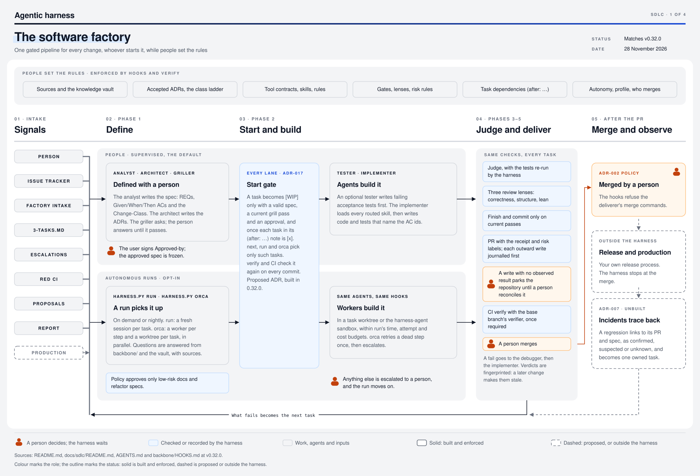
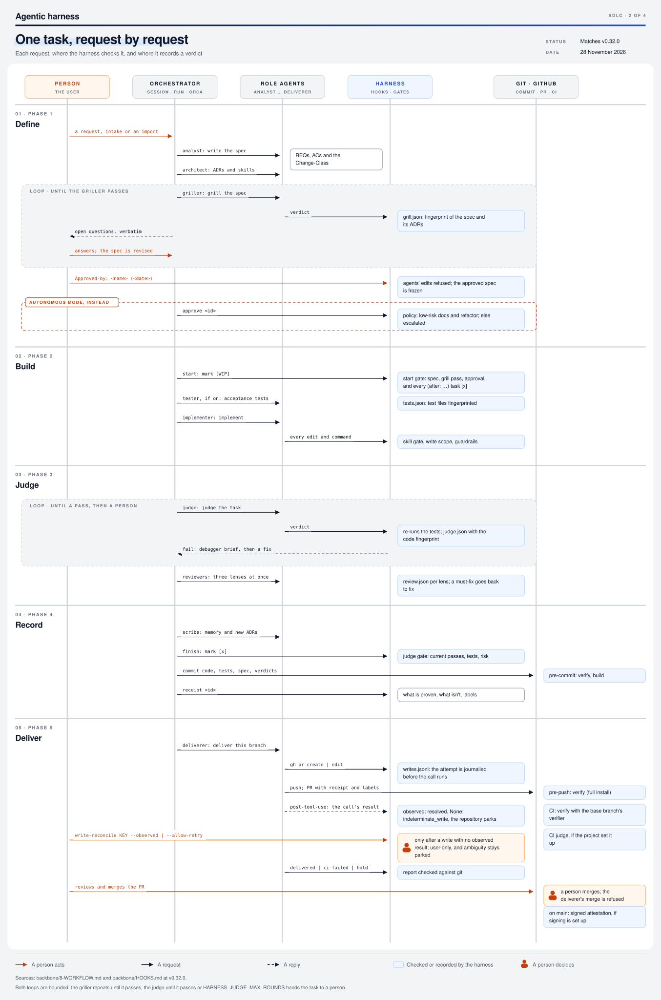
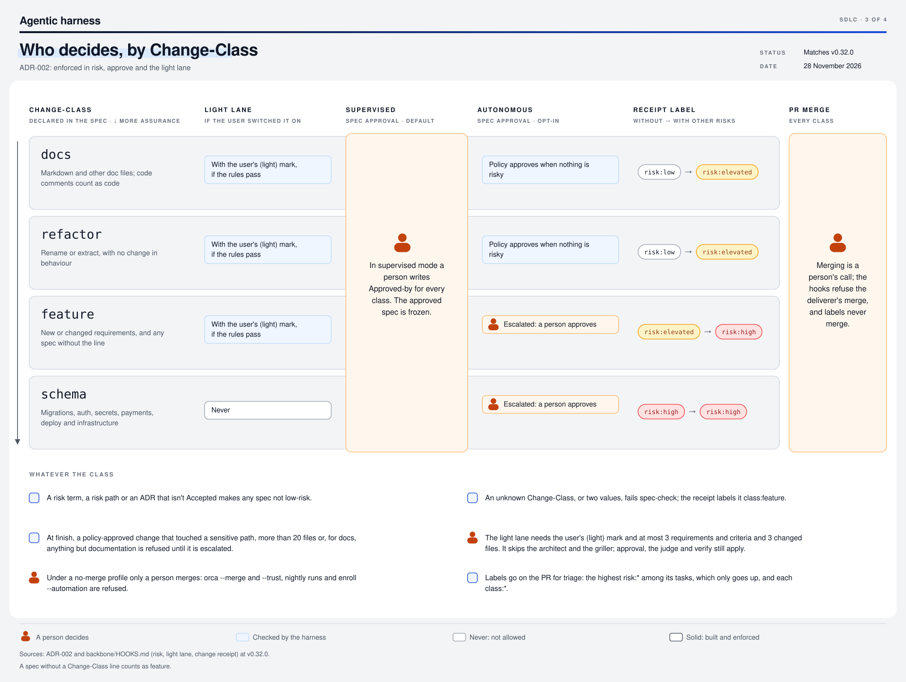
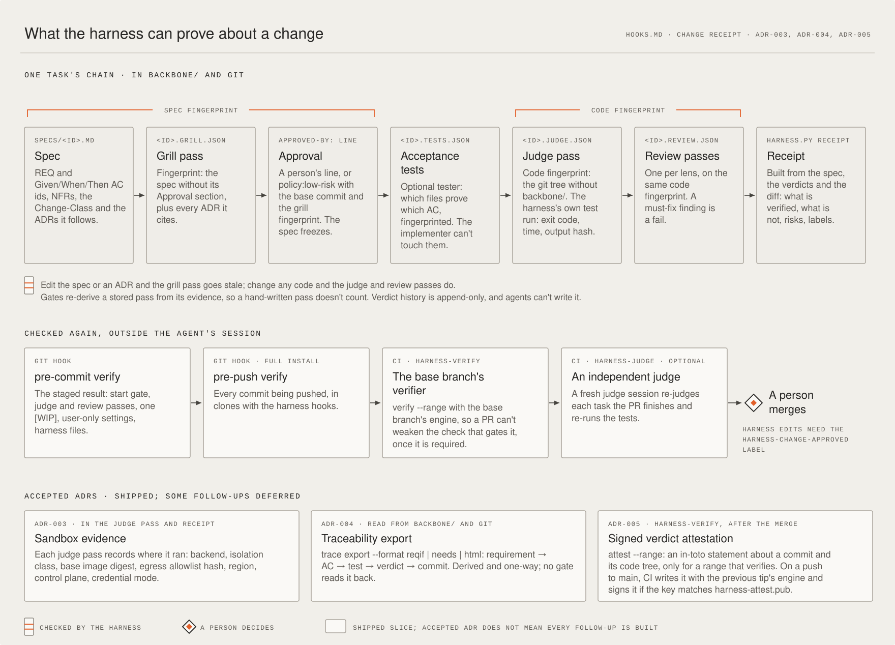

# Agentic Harness

A stack-agnostic harness for AI coding agents such as Claude Code, Codex and OpenCode. Install it into any git
repository and every change goes through **one defined, gated pipeline**, whoever or whatever starts it, while people
set the rules. The four diagrams below are explained in [docs/sdlc](docs/sdlc/README.md). Solid shapes show shipped
harness mechanisms, and enforcement depends on the project's enabled gates and required CI checks; dashed ones show
unbuilt behavior or behavior outside the harness, since ADR acceptance and implementation status are separate; the
orange person marks each point where the harness waits for a human.

The harness never generates application code. On the first session, the agent interviews you to fill in the project's
knowledge, stack ADR, language skill and routes. Requirements: `git` and `python3` (3.8 or later, standard library
only).

## The factory



- **People set the rules.** Only the user accepts an ADR, writes the tool contracts in `tools.conf`, admits or
  revokes third-party skills in `admissions.conf`, or changes the user-only keys of `harness.conf`.
- **Signals.** Work starts from a person, a Linear ticket (`harness.py linear import`) or the task list, and from the
  harness's own feedback: escalations, red CI, failure-class proposals and `harness.py report` candidates.
- **Two lanes, one standard.** A supervised session (the default) or an autonomous run; either way the task passes the
  judge, the three review lenses, verify and `harness-verify` in CI. Then a person merges the pull request (ADR-002).
- **What fails becomes the next task.** Tracing a production incident back to its pull request and spec is accepted
  in [ADR-007](docs/adr/ADR-007-evidence-closed-loop.md), but not built.

[ADR-008](docs/adr/ADR-008-harness-inside-agent-factory.md) (Accepted) places this pipeline inside each lane of an
always-on agent software factory: the factory owns the doors, sender checks, identity, keys and lanes; the harness owns
everything inside a lane and stays the system of record for task state. The harness side of that contract ships in
0.31.0 (contract v1, provenance intake, per-task budgets, external delivery, the `no-merge` profile); the factory's
own adapter is unverified, and the [readiness audit](docs/research/2026-11-factory-integration-readiness.md) lists what
a live pilot still needs.

## One task, request by request



- **Definition first**: one spec per task, questioned by an adversarial `griller` until it passes (a light-lane task
  skips it), then approved by the user. An approved spec is frozen.
- **Skills and tools**: `routing.conf` names the skills an agent must load before it edits a file, and
  `backbone/tools.conf` says what each tool may do.
- **Judging and review**: an independent `judge`, whose verdict a hook re-derives from the evidence, then three
  `reviewer`s, one lens each: correctness, structure and lean.
- **Delivery**: the `deliverer` pushes the branch, opens the pull request with each task's receipt and watches CI. It
  can't merge.

## Who decides, by Change-Class



- The spec declares its `Change-Class`: `docs`, `refactor`, `feature` or `schema`
  ([ADR-002](docs/adr/ADR-002-change-class-ladder.md)). The class decides whether the light lane applies, whether
  autonomous mode may approve the spec by policy, and which risk label the receipt suggests.
- Whatever the class, a person approves every spec in supervised mode and merges the pull request.
- Autonomous mode (opt-in, user-only) approves only low-risk `docs` and `refactor` specs and escalates the rest. A kill
  switch halts everything.

## What the harness can prove



- **Change receipt** (`harness.py receipt <id>`): what changed, each acceptance criterion with its tests and what is
  *not* verified, built from the spec, the verdicts and the diff, not from what the agents said.
- **Verify**: the gates are checked again on every commit and, in CI, with the **base branch's** verifier.
- **Traceability export** ([ADR-004](docs/adr/ADR-004-traceability-export.md)) and optional **signed verdict
  attestations** ([ADR-005](docs/adr/ADR-005-verdict-attestations.md)).
- **What binds whom**: the hooks and gates bind agents; CI's `harness-verify` is what binds everyone, once it is
  required.

## Install

```sh
./bootstrap.sh /path/to/repo [--name my-service] [--git-init] [--dry-run]
cd /path/to/repo && git add -A && git commit -m "chore: adopt agentic harness"
```

Then start an agent session in that repo. It reports **SETUP INCOMPLETE** and runs first-run setup with you
(`AGENTS.md` section 1). After a fresh clone, each developer runs `git config core.hooksPath scripts/harness/git-hooks`
once. `./update.sh status /path/to/repo` shows what is outdated or edited locally, and `./update.sh /path/to/repo`
applies the update. Updating, switching modes and what each install writes: [docs/install.md](docs/install.md).

## Thin mode

In thin mode the engine isn't copied into the project: an agent plugin, installed once per machine, runs the release
the project pins ([ADR-001](docs/adr/ADR-001-thin-mode-plugin.md)). Install the plugin for each agent CLI you use, at
the release your projects pin:

- Claude Code: `/plugin marketplace add soyPeter/agentic-harness#v<version>`, then
  `/plugin install agentic-harness@agentic-harness`. A thin project names both in `.claude/settings.json`, so Claude
  Code offers them to teammates.
- Codex: `codex plugin marketplace add soyPeter/agentic-harness --ref v<version>`, then
  `codex plugin add agentic-harness@agentic-harness`. Codex runs the plugin's hooks once you trust them (`/hooks`).
- OpenCode: a global plugin file, `~/.config/opencode/plugins/agentic-harness.js`, containing
  `export { default } from "/path/to/agentic-harness/plugin/opencode.js";`, where the path is a checkout of the
  release.

Then start a project from its repository root with
`python3 /path/to/agentic-harness/plugin/launcher.py init --thin [--version <version>]` (in Claude Code,
`/agentic-harness:init`), and commit what it writes. Moving the pin, switching an installed project
(`update.sh --to-thin`, `update.sh --to-full`), CI and the limits: [docs/install.md](docs/install.md#thin-mode).

## Driving it

- **Agent CLIs**: the same gates for Claude Code, Codex and OpenCode, and the Codex and OpenCode role agents are
  generated from the Claude Code ones ([HOOKS.md](payload/owned/backbone/HOOKS.md#agent-clis-claude-code-codex-opencode)).
- **Orca coordinator** (`harness.py orca`): drives tasks in parallel with Orca supervised workers, one per step and one
  worktree per task ([HOOKS.md](payload/owned/backbone/HOOKS.md#orca-coordinator-harnesspy-orca)).
- **Coordinator API**: `state`, `next`, `questions`, `start`, `finish` and `contract --json` let a coordinator or an
  agent factory drive tasks without knowing the workflow, and `intake` turns a factory request into a task
  ([HOOKS.md](payload/owned/backbone/HOOKS.md#coordinator-api)).
- **Runner**: `harness.py run` drives ready tasks unattended, one fresh agent session per task, with time and cost
  budgets ([HOOKS.md](payload/owned/backbone/HOOKS.md#runner-harnesspy-run)).
- **Knowledge source** (opt-in, user-only): in autonomous mode, griller questions `backbone/` can't answer are looked
  up in a read-only notes vault, with citations the harness checks
  ([HOOKS.md](payload/owned/backbone/HOOKS.md#knowledge-source-harness_knowledge_root)).
- **Observability**: `harness.py report` summarises the event log, and `harness.py trace <id>` shows one task's
  history ([HOOKS.md](payload/owned/backbone/HOOKS.md#event-log-trace-and-report)).
- **Eval replay**: refused and allowed hook calls are captured, exported as fixtures the user commits, and replayed
  against an engine ([HOOKS.md](payload/owned/backbone/HOOKS.md#captured-calls-and-eval-replay-harnesspy-eval)).

## Stack-neutral by design

The harness assumes no language, framework or tool. The stack is decided in the design phase, in an ADR you accept;
only then does the project adopt matching packs from the catalog, which ships with every install but stays inert. The
packs and their options: [docs/catalog.md](docs/catalog.md).

## Where everything lives

| Where | What |
|---|---|
| [docs/sdlc](docs/sdlc/README.md) | The four diagrams above, explained step by step |
| [docs/install.md](docs/install.md) | Install, update, thin mode, switching modes, and what each install writes |
| [docs/enforcement.md](docs/enforcement.md) | Enrolling every project, the machine guard, the Orca skill, profiles |
| [docs/catalog.md](docs/catalog.md) | The stack packs and their options |
| [HOOKS.md](payload/owned/backbone/HOOKS.md) | Every hook, gate, command and setting, in full; installed as `backbone/HOOKS.md` |
| [AGENTS.md](payload/owned/AGENTS.md), [8-WORKFLOW.md](payload/owned/backbone/8-WORKFLOW.md) | The rules every agent follows, the orchestration loop and the Definition of Done |
| [0-START-HERE.md](payload/owned/backbone/0-START-HERE.md) | The map of a project's `backbone/` |
| [docs/adr](docs/adr/README.md) | The harness's decisions, with their status |
| [docs/research](docs/research/README.md) | The plans, audits and research behind them |
| [catalog/triple](catalog/triple/README.md) | The `triple` pack: Triple's delivery policy for a supervised pilot |
| [Orca skill](orca/skills/agentic-harness/SKILL.md) | For coordinators that drive a harness repository in Orca by hand |
| [docs/development.md](docs/development.md) | Working on the harness itself: tests, releases, repository layout |
| [CHANGELOG.md](CHANGELOG.md) | What each release changed |
