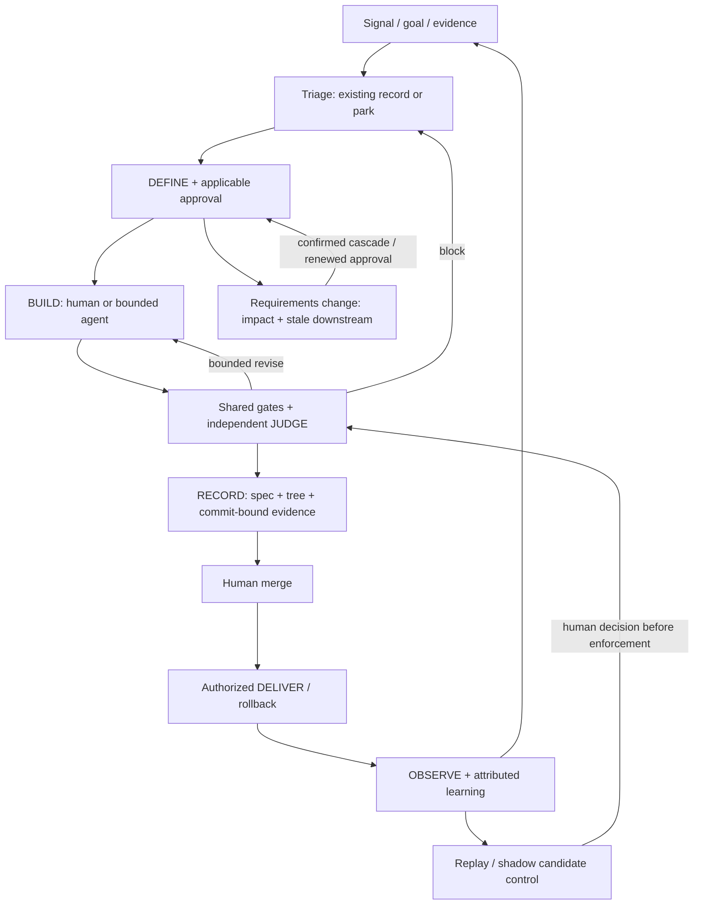

# ADR draft — Extend agentic-harness with an evidence-driven closed loop

| Field | Value |
| --- | --- |
| Status | **Proposed — not accepted or implemented** |
| Date | 2026-11-07 |
| Draft identifier | `agentic-harness-evidence-closed-loop`; repository ADR number **unassigned** |
| Target | [soyPeter/agentic-harness](https://github.com/soyPeter/agentic-harness), not Harness.io |
| Decision class | Human-reviewed cross-change architecture decision; not an automatic implementation choice |
| Proposed decision authority | Repository human maintainer; independent workflow/security reviewer. Roles proposed, no assignment or sign-off recorded |
| Supersedes | None. Complements, does **not** replace [ADR-002 Change-Class ladder](https://github.com/soyPeter/agentic-harness/blob/6f29275fb76fd82161192f0b54a931249518753d/docs/adr/ADR-002-change-class-ladder.md) |
| Implementation companion | [[plt-SDD-Agentic-Harness-Implementation-Plan-2026-11]] — packages, tests, dependencies and rollback details |

This is the canonical KB proposal. Saving it does not adopt governance, authorize work, change source code, create a repository ADR/PR or approve any merge. Repository placement/numbering is a later human decision.

## Context and problem

The harness already has a lifecycle, Change-Class policy, independent judging, verdict fingerprints, receipts and delivery controls. The question is **how to evolve that system**, not whether to install a second factory. A task may pass checks yet become stale when requirements change, or fail after deployment without its outcome feeding back into the controls that approved it. Adding more agents or prose alone does not close those gaps.

**Evidence boundary:** the companion plan's baseline was verified **7 Nov 2026 at 16:17, Europe/Madrid (CET)** through narrow read-only GitHub metadata and documentation. Main was `6f29275fb76fd82161192f0b54a931249518753d`, VERSION `0.30.0`; [#48](https://github.com/soyPeter/agentic-harness/pull/48) and [#54](https://github.com/soyPeter/agentic-harness/pull/54) were merged; [#56](https://github.com/soyPeter/agentic-harness/pull/56) enforcement fixes and [#52](https://github.com/soyPeter/agentic-harness/pull/52) labels/deliverer changes were open. These are **historical snapshot facts, not a current status check**. README promises were not independently executed; open-PR defect reports are author claims awaiting review. Branch metadata showed protection/checks off, but effective forge rules were not fully audited. See the plan for pending thin-mode work and stale local-worktree cautions.

### Forces

- Reuse working controls and reconcile pending fixes before expanding policy or autonomy.
- Acceptance depends on observable behavior and valid evidence, not the builder's summary or a quality/confidence score.
- Requirements change; traceability must identify affected artifacts without rebuilding unrelated work indiscriminately.
- Runtime outcomes must inform control quality without claiming correlation proves causation.
- Preserve a lightweight docs/refactor lane, existing project conventions and tool/model portability.
- Every layer costs context, execution, review and maintenance. Benefits must be demonstrated on representative tasks.
- Permissions and enforcement must survive untrusted inputs and failures; production access is not implied by planning access.

## Options considered

| Option | Advantages | Costs / limits | Disposition |
| --- | --- | --- | --- |
| **A. Stabilize current pipeline and add improvements case by case** | Lowest immediate architectural cost; keeps current controls and existing teams/tools; viable if incidents and drift remain rare | Cross-artifact staleness and feedback depend on manual discipline; difficult to reproduce policy decisions or compare changes consistently | Retain as a safe interim while stabilizing, not the target once repeated drift is demonstrated |
| **B. Incrementally extend the existing harness with versioned evidence, impact invalidation and feedback interfaces** | Reuses fingerprints, Change-Class, judge and receipts; makes claims auditable; integrates current backlog/cadence; optional expensive layers can be evaluated independently | Requires schema/migration design, attribution discipline, replay fixtures and ongoing maintenance; false invalidation can slow delivery | **Recommended**, gated by audit, measured need and staged acceptance |
| **C. Adopt an external integrated workflow/framework as the primary lifecycle** | Potentially faster access to packaged specs/delegation/QA; AgentSpec and runtime QA services illustrate reusable mechanisms | Migration and overlapping sources of truth; data/security review, vendor/tool coupling; published inventories/claims do not show a better fit or outcome here | Defer replacement pending a bounded comparison. Reusable components may be evaluated without transferring governance |

No option removes independent verification or human PR merge. A is not “no quality controls”; C is not assumed incapable. B is preferred because it addresses the traceability problem while minimizing replacement and preserving existing investment, not because an end-to-end factory has been proven cheaper or safer for this repo.

## Recommended decision

**Extend the existing DEFINE → BUILD → JUDGE → RECORD → DELIVER lifecycle into a source-independent, evidence-driven closed loop, with explicit requirements-impact invalidation.** Add only audited missing capabilities. Keep authority in deterministic controls and human decisions; model reasoning proposes and interprets but cannot confer permission.

### Invariants

1. **Human PR merge remains mandatory for this architecture.** Existing eligible low-risk *spec* policy approval is not merge/deploy authority. ADR-002 class and escalation rules remain; malformed/ambiguous classifications fail closed under the agreed policy.
2. **Independent JUDGE:** separate builder/reviewer context; judge consumes requirements, diff and executable evidence. Source-independent minimum CI/security guarantees apply to human- and agent-authored changes, with risk-appropriate depth. No obligatory browser QA for a documentation change.
3. **Evidence binds what was tested to what is delivered.** Use spec revision plus tested tree/code fingerprint before commit; bind the committed SHA by content equivalence or rerun affected checks. Never invent a future SHA. Retain command, result/exit status, environment/fixture reference, AC coverage and explicit unknown/unverified areas. Receipts are evidence references, not approval tokens.
4. **Truthful states:** passing ≠ independently accepted ≠ merged ≠ deployed ≠ enabled for a client ≠ observed outcome. Risk labels and numerical scores cannot promote those states.
5. **One operating model:** for Triple, Linear remains the work/decision record and Monday the single status report. No parallel agent backlog, extra recurring meeting or duplicative product-state file. Other projects use an explicit adapter, not forced Linear adoption.
6. **Bounded action:** repair/review loops have explicit limits and destination (repair, review, escalate, park or reject). Limits reuse existing policy or require approval; no invented retry budget here. Worktrees alone do not establish runtime isolation; verify ports, database/schema, environment, credentials and integration before increasing parallelism.

### Interfaces and semantics

**SIGNAL / TRIAGE:** input is a candidate signal with source reference, goal, client scope if relevant, existing item/deduplication key, evidence and accountable role/assignee. Output is an existing work item with proceed/park/reject/escalate decision, reason and next action. A signal is not authority to build. Incident escalation remains outside normal backlog waiting.

**DEFINE / change impact:** retain PRD → RFC → CHNG / ADR links where applicable, REQ/AC identifiers and Change-Class. Add only missing assumptions (ID, impact if wrong, validation evidence/state) and bounded ownership/dependency references. Requirements quality is reviewed; a heuristic clarity score is not calibrated probability or approval. A change to an AC, constraint, assumption, architecture or risk boundary triggers downstream impact analysis. Mark affected design/tasks/checks/verdicts/receipts and applicable approvals stale; surface unknown dependencies conservatively. Preview impact and obtain confirmation before cascading edits; renew required approval. Preserve immutable history, do not rewrite a prior accepted decision. Unaffected evidence is reusable only when its independence is demonstrated.

**RECORD / feedback:** OBSERVE accepts authorized rollout/behavior/incident evidence linked to revision/client/environment and then to PR/change/spec. Attribution is **confirmed, suspected or unknown**, with its evidence. It emits one owned, deduplicated learning action, not automatic code changes. That action may add a regression case, propose a control change or explicitly park the finding. Policy candidates are evaluated on replay before human-approved enforcement.

### Policy rollout

Separate report-only/shadow from enforcement. Shadow candidates cannot change approvals, trigger merges, launch production repairs or bypass mandatory security gates. Replay uses resettable representative fixtures, pinned model/harness/environment and an evaluator whose expected outcomes are independent of the builder. Track false blocks, missed defects and infrastructure failures separately. Compare one variable at a time; retain existing required controls while evaluating feedback frequency or optional orchestration. Model upgrades trigger review of layer value, not automatic deletion of safety boundaries.

## Consequences

**Positive:** reviewable provenance, reduced stale-proof risk, explicit unknowns, owned learning destinations, reusable deterministic checks and optional layer evaluation without a platform replacement. Shared evidence supports existing meetings rather than more reporting.

**Negative:** dependency metadata can drift; invalidation may be overbroad or incomplete; fixtures, schema migrations and independent reviews cost effort; attribution and sensitive trace handling require discipline. A complete-looking graph is not proof of complete requirements. More recorded evidence can increase storage/privacy exposure. No outcome or ROI improvement is claimed until evaluated.

## Security and rollback

Least-privilege tool contracts, untrusted-source separation, synthetic/redacted fixtures, no production credentials by default, and controlled access/retention for traces are required design constraints. Exact retention and permissions need project approval. Specs, scripts and agent output cannot override forge/deploy controls. Human-merge enforcement must be checked across CLI/API routes and effective forge rules, not inferred from prose.

Changes use versioned additive metadata where possible. Unsupported or unbound evidence is historical/unknown, never silently accepted. Roll back candidate controls to the last reviewed configuration or report-only mode; retain raw evidence and mandatory checks. Disable feedback adapters without deleting backlog items or audit history. Serialize execution if isolation fails. Revert source changes through reviewed normal workflow; never reset pending worktrees or revive known bypasses just to restore throughput.

## Adoption and objective acceptance

The companion plan owns implementation sequencing, not this ADR. **P0** refresh baseline and independently reconcile #56/#52 plus existing thin-mode work; **P1** audit/extend invalidation, contracts and receipt binding; **P2** introduce provenance adapters and replay/shadow; **P3** consider parallelism only after verified isolation and a demonstrated bottleneck. Existing implementation found by audit is tested/reused, not rebuilt. Repository edits, agents and merges require separate authorization.

Before declaring adoption, produce reproducible evidence that:

- An AC/risk/assumption change cannot reuse affected approval or receipt, and unrelated evidence is retained only with a demonstrated independent dependency.
- Precommit fingerprints and committed artifacts bind truthfully; code/spec changes stale affected evidence; failed or absent execution cannot appear as passing.
- Invalid/hidden/conflicting classes and rename/deletion paths cannot evade applicable gates; legacy artifacts fail safely without losing history.
- Human- and agent-authored equivalent changes face the same minimum gates; builder cannot approve its own result, weaken expectations unnoticed or merge via an alternate tool route.
- A duplicate signal creates no duplicate repair; parked work remains parked; a production regression links to a PR or remains explicitly unattributed and yields one owned next action.
- Replay is resettable and independent, distinguishes infrastructure failure from task failure, records false blocks/missed defects, and shadow output cannot mutate authority.
- A fresh session resumes from versioned evidence/checkpoint without the previous chat. Concurrent tasks, if enabled, cannot contaminate runtime state and are checked together at integration.

Record exact revisions, commands, exit status, fixtures, negative cases and independent review. Baseline tests must reproduce the targeted defect where applicable, then pass on the candidate; run current repository regression checks. No arbitrary coverage %, duration, cost improvement or “regret-free” threshold is adopted. Acceptance-case completeness and policy rollout criteria still require human agreement.

## Unresolved boundaries and proposed roles

| Boundary | Proposed accountable role / required decision |
| --- | --- |
| Accept ADR; repository number/location; authorize P0 | Human repository maintainer; not signed off by this draft |
| Impact schema, dependency scope and legacy migration | Workflow maintainer with independent verification reviewer; scoped code audit first |
| Project gates, permission boundaries, forge enforcement | Security/reliability reviewer plus human policy authority; verify actual configuration |
| Attribution, client observation scope and existing cadence | Existing product/incident owners; agree evidence coverage without inventing SLAs |
| Replay set, thresholds and optional layer removal | Evaluator independent of builder proposes; human policy authority approves before enforcement |

No named person has been assigned new work by this record. Exact storage schemas, command names, file layouts, budgets and implementation changes are deliberately left to audit/design. Revisit the recommendation if the current system already satisfies these criteria, representative evaluation shows the added layer is not worth its cost, migration breaks safety, or an external component demonstrates a better fit under the same constraints.

## Non-goals

Automerge, unsupervised production repair/deploy, adopting AgentSpec/Ito/another platform by default, changing ADR-002 or creating a second approval ladder, fixed specialist counts/confidence thresholds, new calendar rituals, importing benchmark metrics as targets, or asserting a compliance certification. This proposal is not a code audit or approval of any currently open PR.

## Evidence and references

- [[plt-SDD-Agentic-Harness-Implementation-Plan-2026-11]]: dated baseline, proposed packages and tests; source for repo-state claims.
- [[plt-SDD-DevExpert-Harness-Engineering-2026-11]]: [Leiva, 7 Nov 2026](https://devexpert.io/blog/harness-engineering), full article; sells training/starter. [Anthropic, long-running harnesses](https://www.anthropic.com/engineering/effective-harnesses-for-long-running-agents), full report, web-app-specific; multi-agent superiority remains open. [Jain, harness economics](https://martinfowler.com/articles/are-harnesses-worth-the-cost.html), full single-service small-sample experiment; does not prove our ROI or that final-only gates were experimentally better.
- [[plt-SDD-Medium-Agentic-SDLC-AgentSpec-2026-06]]: [Manish](https://medium.com/@manishmshiva/the-agentic-sdlc-how-ai-is-transforming-software-development-b6bed6d3991d), [Lorenzo](https://medium.com/@lorenzouriel/my-workflow-with-claude-spec-driven-development-with-agentspec-82e9003f8445); full article coverage documented there. [AgentSpec ITERATE primary](https://github.com/luanmorenommaciel/agentspec/blob/e00f832c4d9949572c17d57621a3fd7f28ca2400/.claude/skills/sdd-iterate/SKILL.md): cascade/versioning mechanism. Inventories and static confidence categories are not calibrated benefit evidence; current repo differs from June article.
- [[plt-SDD-X-Bookmarks-Factory-SDLC-2026-11]]: [Eno Reyes](https://x.com/EnoReyes/status/2118767454721851680), Factory CTO, full post/diagram; [Tan](https://x.com/poteto/status/2118613050462728659), deterministic-engineering counterpoint; [Uber](https://www.uber.com/us/en/blog/securing-ai-agents/), intent/provenance and replay. Vendor/internal-platform experience informs design, not proof of this proposal's effectiveness.

Record format follows the KB decision-record SOP (via [[del-Hub-SOPs]]): context, genuine alternatives, recommended choice, rationale and consequences; preserve history rather than overwrite accepted decisions.
