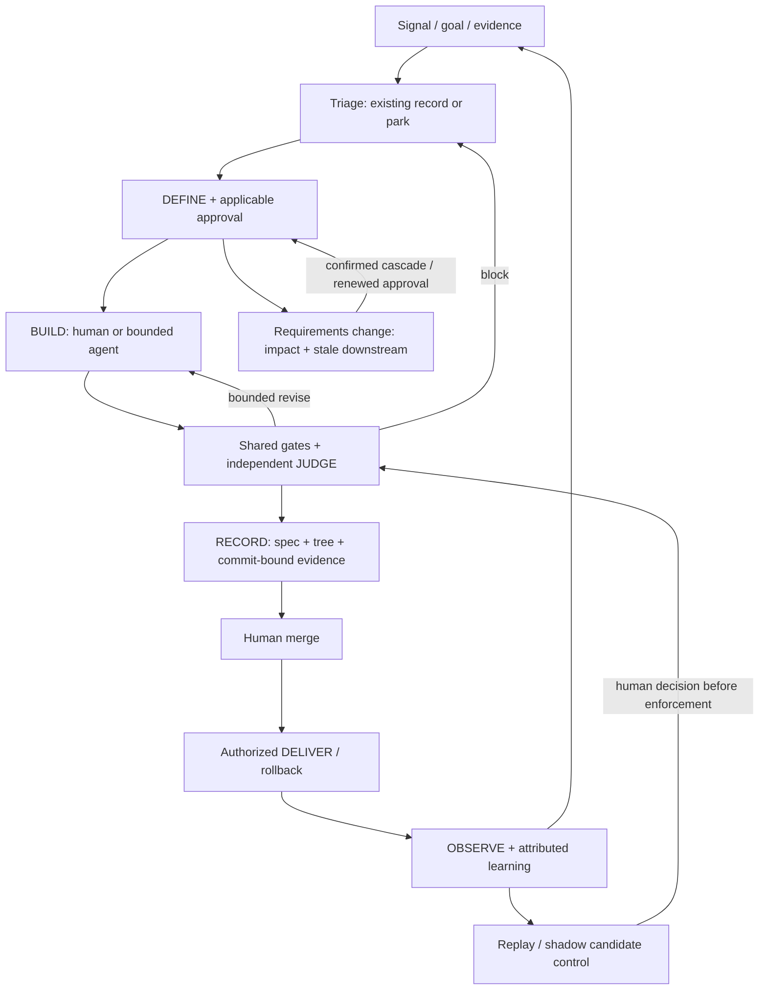

# ADR-007: Evidence-driven closed loop

## Status
Proposed

## Date
2026-11-07, revised 2026-11-10 (renumbered from a draft that clashed with [ADR-003](ADR-003-sandbox-backends.md))

## Context
The harness already has a lifecycle, Change-Class policy, independent judging, verdict fingerprints, receipts and
delivery controls. The question is how to evolve that system, not whether to install a second factory. A task may pass
checks and then become stale when requirements change. It may also fail after deployment without that outcome feeding
back into the controls that approved it. Adding more agents or more prose does not close those gaps.

This ADR complements [ADR-002](ADR-002-change-class-ladder.md). It does not replace it. Implementation sequencing lives
in the [delegation-contracts qualification plan](../research/2026-11-delegation-contracts-qualification-plan.md). Saving
or merging this document does not adopt the work, authorize implementation, or approve any merge.

The decision has to:

- Reuse working controls and reconcile pending fixes before expanding policy or autonomy.
- Make acceptance depend on observable behavior and valid evidence, not the builder's summary or a quality score.
- Handle changing requirements. Traceability must identify affected artifacts without rebuilding unrelated work at
  random.
- Let runtime outcomes inform control quality without treating correlation as causation.
- Preserve a lightweight docs and refactor lane, existing project conventions, and tool and model portability.
- Show its benefits on representative tasks. Every layer costs context, execution, review and maintenance.
- Keep permissions and enforcement intact under untrusted inputs and failures. Planning access does not imply production
  access.

**Evidence boundary.** The companion plan's baseline was verified on 7 Nov 2026 at 16:17, Europe/Madrid (CET), through
narrow read-only GitHub metadata and documentation. Main was `6f29275fb76fd82161192f0b54a931249518753d`, VERSION
`0.30.0`. Pull requests [#48](https://github.com/soyPeter/agentic-harness/pull/48) and
[#54](https://github.com/soyPeter/agentic-harness/pull/54) were merged.
[#56](https://github.com/soyPeter/agentic-harness/pull/56) enforcement fixes and
[#52](https://github.com/soyPeter/agentic-harness/pull/52) labels and deliverer changes were still open. These are
historical snapshot facts, not a current status check. README promises were not independently executed. Open-PR defect
reports are author claims awaiting review. Branch metadata showed protection and checks off, but effective forge rules
were not fully audited.

Sources, and how far each was read:

- Companion plan in this repository:
  [2026-11-delegation-contracts-qualification-plan.md](../research/2026-11-delegation-contracts-qualification-plan.md).
  Dated baseline, proposed packages and tests. Source for repo-state claims in the original draft.
- [Leiva, 7 Nov 2026](https://devexpert.io/blog/harness-engineering), full article. Sells training and a starter.
  [Anthropic, long-running harnesses](https://www.anthropic.com/engineering/effective-harnesses-for-long-running-agents),
  full report, web-app-specific. Multi-agent superiority remains open.
  [Jain, harness economics](https://martinfowler.com/articles/are-harnesses-worth-the-cost.html), full single-service
  small-sample experiment. It does not prove ROI here, or that final-only gates were experimentally better.
- [Manish](https://medium.com/@manishmshiva/the-agentic-sdlc-how-ai-is-transforming-software-development-b6bed6d3991d) and
  [Lorenzo](https://medium.com/@lorenzouriel/my-workflow-with-claude-spec-driven-development-with-agentspec-82e9003f8445).
  [AgentSpec ITERATE primary](https://github.com/luanmorenommaciel/agentspec/blob/e00f832c4d9949572c17d57621a3fd7f28ca2400/.claude/skills/sdd-iterate/SKILL.md):
  cascade and versioning mechanism. Inventories and static confidence categories are not calibrated benefit evidence.
- [Eno Reyes](https://x.com/EnoReyes/status/2118767454721851680), Factory CTO, full post and diagram.
  [Tan](https://x.com/poteto/status/2118613050462728659), deterministic-engineering counterpoint.
  [Uber](https://www.uber.com/us/en/blog/securing-ai-agents/), intent, provenance and replay. Vendor or
  internal-platform experience informs design. It is not proof that this proposal works.

Supporting notes also exist in the private knowledge-base repository. They are not linked from this file, because those
paths do not resolve in this repository.

## Decision
Extend the existing DEFINE, BUILD, JUDGE, RECORD and DELIVER lifecycle into a source-independent, evidence-driven closed
loop, with explicit invalidation when requirements change. Add only capabilities that an audit shows are missing.
Authority stays in deterministic controls and human decisions. Model reasoning may propose and interpret. It cannot
confer permission.

The extension is incremental: versioned evidence, impact invalidation and feedback interfaces, gated by audit, measured
need and staged acceptance. It reuses fingerprints, Change-Class, the judge and receipts. It makes claims auditable and
integrates with the current backlog and cadence, and optional expensive layers can be evaluated independently. It is
preferred because it addresses the traceability problem, limits replacement and preserves existing investment. It is not
preferred because an end-to-end factory has been proven cheaper or safer for this repository. No option considered
removes independent verification or human PR merge.

### Invariants
1. **Human PR merge remains mandatory for this architecture.** Existing eligible low-risk spec policy approval is not
   merge or deploy authority. ADR-002 class and escalation rules remain. Malformed or ambiguous classifications fail
   closed under the agreed policy.
2. **Independent JUDGE.** Separate the builder and reviewer context. The judge consumes requirements, the diff and
   executable evidence. The same minimum CI and security guarantees apply to human-authored and agent-authored changes,
   with risk-appropriate depth. A documentation change does not require browser QA.
3. **Evidence binds what was tested to what is delivered.** Use the spec revision plus the tested tree or code
   fingerprint before commit. Bind the committed SHA by content equivalence or by rerunning the affected checks. Never
   invent a future SHA. Keep the command, result or exit status, environment or fixture reference, acceptance-criterion
   coverage, and explicit unknown or unverified areas. Receipts are evidence references, not approval tokens.
4. **Truthful states.** Passing is not independently accepted. Independently accepted is not merged. Merged is not
   deployed. Deployed is not enabled for a client. Enabled is not an observed outcome. Risk labels and numerical scores
   cannot promote those states.
5. **One operating model.** For Triple, Linear remains the work and decision record, and Monday remains the single
   status report. There is no parallel agent backlog, extra recurring meeting, or duplicative product-state file. Other
   projects use an explicit adapter. They are not forced onto Linear.
6. **Bounded action.** Repair and review loops have explicit limits and a destination: repair, review, escalate, park or
   reject. Limits reuse existing policy or require approval. This ADR does not invent a retry budget. Worktrees alone do
   not establish runtime isolation. Verify ports, database or schema, environment, credentials and integration before
   increasing parallelism.

### Interfaces and semantics
**SIGNAL / TRIAGE.** Input is a candidate signal with a source reference, a goal, client scope if relevant, an existing
item or deduplication key, evidence, and an accountable role or assignee. Output is an existing work item with a
proceed, park, reject or escalate decision, a reason, and a next action. A signal is not authority to build. Incident
escalation stays outside normal backlog waiting.

**DEFINE / change impact.** Keep PRD to RFC to CHNG / ADR links where they apply, plus REQ and AC identifiers and
Change-Class. Add only missing assumptions (an id, the impact if wrong, and validation evidence or state) and bounded
ownership or dependency references. Requirements quality is reviewed. A heuristic clarity score is not a calibrated
probability or an approval. A change to an acceptance criterion, constraint, assumption, architecture or risk boundary
triggers downstream impact analysis. Mark affected design, tasks, checks, verdicts, receipts and applicable approvals
stale. Surface unknown dependencies conservatively. Preview impact and obtain confirmation before cascading edits. Renew
required approval. Preserve immutable history. Do not rewrite a prior accepted decision. Unaffected evidence is reusable
only when its independence is demonstrated.

**RECORD / feedback.** OBSERVE accepts authorized rollout, behavior or incident evidence linked to a revision, client
and environment, and then to a PR, change or spec. Attribution is confirmed, suspected or unknown, with its evidence. It
emits one owned, deduplicated learning action, not automatic code changes. That action may add a regression case,
propose a control change, or explicitly park the finding. Policy candidates are evaluated on replay before
human-approved enforcement.

### Policy rollout
Keep report-only or shadow mode separate from enforcement. Shadow candidates cannot change approvals, trigger merges,
launch production repairs or bypass mandatory security gates. Replay uses resettable representative fixtures, a pinned
model, harness and environment, and an evaluator whose expected outcomes are independent of the builder. Track false
blocks, missed defects and infrastructure failures separately. Compare one variable at a time. Keep existing required
controls while evaluating feedback frequency or optional orchestration. A model upgrade triggers a review of layer
value. It does not automatically delete safety boundaries.

### Adoption criteria
The companion plan owns implementation sequencing, not this ADR. **P0** refreshes the baseline and independently
reconciles #56 and #52 plus existing thin-mode work. **P1** audits and extends invalidation, contracts and receipt
binding. **P2** introduces provenance adapters and replay or shadow. **P3** considers parallelism only after verified
isolation and a demonstrated bottleneck. Existing implementation found by audit is tested and reused, not rebuilt.
Repository edits, agents and merges require separate authorization.

Before declaring adoption, produce reproducible evidence that:

- A change to an acceptance criterion, risk or assumption cannot reuse an affected approval or receipt, and unrelated
  evidence is retained only with a demonstrated independent dependency.
- Precommit fingerprints and committed artifacts bind truthfully. Code or spec changes stale affected evidence. Failed
  or absent execution cannot appear as passing.
- Invalid, hidden or conflicting classes, and rename or deletion paths, cannot evade applicable gates. Legacy artifacts
  fail safely without losing history.
- Human-authored and agent-authored equivalent changes face the same minimum gates. The builder cannot approve its own
  result, weaken expectations unnoticed, or merge through an alternate tool route.
- A duplicate signal creates no duplicate repair. Parked work remains parked. A production regression links to a PR, or
  remains explicitly unattributed, and yields one owned next action.
- Replay is resettable and independent, distinguishes infrastructure failure from task failure, records false blocks and
  missed defects, and cannot let shadow output mutate authority.
- A fresh session resumes from versioned evidence or a checkpoint without the previous chat. Concurrent tasks, if
  enabled, cannot contaminate runtime state and are checked together at integration.

Record exact revisions, commands, exit status, fixtures, negative cases and independent review. Baseline tests must
reproduce the targeted defect where applicable, then pass on the candidate. Run current repository regression checks.
This ADR does not adopt an arbitrary coverage percentage, duration, cost improvement or "regret-free" threshold.
Acceptance-case completeness and policy rollout criteria still need human agreement.

## Alternatives considered
- **Stabilize the current pipeline and add improvements case by case**: the lowest immediate architectural cost. It
  keeps current controls and existing teams and tools, and is viable if incidents and drift remain rare. But
  cross-artifact staleness and feedback then depend on manual discipline, and policy decisions are harder to reproduce
  or compare. It is not "no quality controls", and it stays as a safe interim while stabilizing. It is not the target
  once repeated drift is demonstrated.
- **Adopt an external integrated workflow or framework as the primary lifecycle**: it may give faster access to packaged
  specs, delegation or QA, and AgentSpec and runtime QA services illustrate reusable mechanisms. But the cost is
  migration, overlapping sources of truth, a data and security review, and vendor or tool coupling, and published
  inventories and claims do not show a better fit or outcome here. It is not assumed incapable: replacement is deferred
  pending a bounded comparison, and reusable components may be evaluated without transferring governance.

## Consequences
- **Easier**:
  - Reviewable provenance, less stale-proof risk, explicit unknowns and owned learning destinations.
  - Reusable deterministic checks, and optional layers evaluated without a platform replacement.
  - Shared evidence supports existing meetings rather than more reporting.
- **Harder**:
  - Schema and migration design, replay fixtures, independent reviews and ongoing maintenance cost effort. Attribution
    and sensitive trace handling need discipline.
  - Dependency metadata can drift. Invalidation may be overbroad or incomplete, and false invalidation can slow
    delivery.
  - A complete-looking graph is not proof of complete requirements.
  - More recorded evidence can increase storage and privacy exposure.
  - No outcome or ROI improvement is claimed until it is evaluated.
- **Security and rollback**:
  - Least-privilege tool contracts, untrusted-source separation, synthetic or redacted fixtures, no production
    credentials by default, and controlled access and retention for traces are required design constraints. Exact
    retention and permissions need project approval.
  - Specs, scripts and agent output cannot override forge or deploy controls. Human-merge enforcement must be checked
    across CLI and API routes and effective forge rules, not inferred from prose.
  - Changes use versioned additive metadata where possible. Unsupported or unbound evidence is historical or unknown,
    never silently accepted.
  - Roll back candidate controls to the last reviewed configuration or to report-only mode. Keep raw evidence and
    mandatory checks. Disable feedback adapters without deleting backlog items or audit history. Serialize execution if
    isolation fails. Revert source changes through the reviewed normal workflow.
  - Never reset pending worktrees or revive known bypasses just to restore throughput.
- **Unresolved boundaries**:
  - Accepting this ADR, and authorizing P0, stays with the human repository maintainer.
  - The impact schema, dependency scope and legacy migration stay with the workflow maintainer and an independent
    verification reviewer, after a scoped code audit.
  - Project gates, permission boundaries and forge enforcement stay with a security or reliability reviewer plus the
    human policy authority, verified against the actual configuration.
  - Attribution, client observation scope and the existing cadence stay with the current product and incident owners.
  - The replay set, thresholds and optional layer removal are proposed by an evaluator independent of the builder, and
    approved by the human policy authority before enforcement.
  - This record assigns no named person new work. Exact storage schemas, command names, file layouts, budgets and
    implementation changes are left to audit and design.
  - Revisit the recommendation if the current system already meets these criteria, if representative evaluation shows
    the added layer is not worth its cost, if migration breaks safety, or if an external component demonstrates a better
    fit under the same constraints.
- **Non-goals**:
  - Automerge.
  - Unsupervised production repair or deploy.
  - Adopting AgentSpec, Ito or another platform by default.
  - Changing ADR-002 or creating a second approval ladder.
  - Fixed specialist counts or confidence thresholds.
  - New calendar rituals.
  - Importing benchmark metrics as targets.
  - Asserting a compliance certification.
  - This proposal is not a code audit or an approval of any currently open PR.

## Implementation notes (2026-11-11)
This section records work done under the ADR while it stays Proposed. It does not accept the ADR. Acceptance is the
maintainer's decision.

**Authority.** The [delegation plan](../research/2026-11-delegation-contracts-qualification-plan.md) records the
decision of 10 Nov 2026: run only the audits (P0 and the P0-V reuse map), and build nothing unless they show real gaps.
The [Orca rollout plan](../research/2026-11-orca-self-rollout-plan.md) records the same rule (D13). P0 below is that
audit. One gap it shows was built, as the first part of P1 ("invalidation and receipt binding"). Nothing else was built.
The skeleton plan stays parked (D12) and is not touched.

**Baseline.** main at `dd2f9e967b375f1dd589dfe980ad00e04aa7b91e` (11 Nov 2026), VERSION `0.30.0`. PR #56 (merged
7 Nov 2026 as `c494efa`) and PR #52 (merged 7 Nov 2026 as `dec213c`) are both on main, so the reconciliation that P0
names is done. Thin mode (ADR-001) shipped in 0.30.0, and this repository is self-enrolled at that pin. Method: read
`harness.py` and `coordinator.py` with the tests that drive them. Every gap marked below was reproduced as a failing
test on this baseline before any change (`tests/test-impact-invalidation.py`: 22 of its 26 tests fail there; the 4
that pass are the controls, where nothing stale is reused). No row relies on the README alone. Forge rules on GitHub were not audited: that needs remote access, which this
local audit did not use.

### P0: invariants and interfaces against the current harness

| ADR-007 requirement | What exists at the baseline (code; tests) | Status |
|---|---|---|
| 1. Human PR merge | The deliverer's gate refuses merges by command, API and MCP tool; the `triple` profile refuses `--merge`. (`role_command_refusal`, `MERGE_ENDPOINT`, `no_merge_refusal`; `test-deliverer-gate.py`) | Covered locally. Effective forge rules not audited |
| 2. Independent JUDGE, same gates for people and agents | A separate judge agent, optionally on another model (`--agents judge=codex`). Verify re-checks the gates in pre-commit and in CI with the base branch's verifier. (`verify_changes`; `run-tests.sh` "verify", `test-attest.py`) | Partial. A commit could change an approved spec and keep its approval line: only the agents' file and shell tools were frozen (`spec_guard`). **Built** |
| 3. Evidence binds the tested tree to what is delivered | The judge, review and tester records carry the code fingerprint. A commit binds by content (`tree_fingerprint` of the commit that finished the task). The harness's own test run is recorded (command, exit, time, output hash). Sandbox evidence (ADR-003). (`record_verdict`, `run_tests`, `done_commit`; `test-code-fingerprint.py`, `test-sandbox-evidence.py`) | Partial. **Gap:** no spec revision on judge, review or tester records, so a receipt mapped the judge's per-criterion claims onto the current spec text by id. **Built** |
| 3. Explicit unknowns | NOT VERIFIED lists unmet criteria, NFRs without a criterion and open findings. | Partial. With `HARNESS_TEST_CMD` empty, the receipt doesn't say the harness ran no tests (doctor warns; autonomous mode refuses). Deferred |
| 4. Truthful states | `next` ends at `done` only after `delivered` (pushed, PR open, CI green); `delivered` is refused against a dirty or unpushed tree or red CI. Labels never approve. Merged, deployed, enabled and observed are not tracked. (`delivery_step`, `record_delivery`) | Covered up to delivery. Later states are absent, not misreported. Deferred |
| 4. Failed or absent execution never passes | A failing or timed-out harness test run turns a claimed pass into a fail; a hand-written pass is re-derived and refused. (`effective_judge`; `run-tests.sh` "the judge's tests are run by the harness") | Covered when `HARNESS_TEST_CMD` is set |
| 6. Bounded action | Grill, judge and lens round limits escalate to BLOCKED; the debugger runs before a fix; Orca stops a step that repeats without progress and retries a worker once; `STOP` halts everything; one `[WIP]` unless the user allows more. (`HARNESS_*_MAX_ROUNDS`, `escalate`, `coordinator.advance`) | Covered. Isolation beyond worktrees (ports, database, environment) is not verified: P3, not started |
| DEFINE / change impact: grill | The grill pass is bound to the spec outside its Approval section and every referenced ADR. (`spec_fingerprint`, `start_problems`) | Partial. **Gap:** the gates read acceptance criteria from anywhere in the spec, and the template puts Approval last, so a criterion appended to a spec landed outside the fingerprint, the freeze and the risk assessment: reworded, it left the grill and judge passes current (found by the independent review of this slice). **Built** |
| DEFINE / change impact: judge, reviews, tester | Bound to the code only. A changed criterion, constraint, assumption, Change-Class or ADR left the judge's pass current. `next` said `finish`, `finish` and verify accepted it, and the receipt showed the old evidence under the new text. | **Gap. Built** |
| DEFINE / change impact: renewed approval | An approved spec is frozen for agents, so changing it means the user removes the approval. Nothing asked for the approval back before finishing: the start gate ran only when a task became `[WIP]`, and verify skipped `[WIP]` to `[x]` although HOOKS.md said it checked "every task that became `[WIP]` or `[x]`". | **Gap. Built** |
| DEFINE / change impact: approval and ADRs | A change to a referenced ADR stales the grill and judge passes, but a user's `Approved-by:` line carries no fingerprint, so it isn't renewed. | Gap. Deferred: needs a decision on how a user's approval is bound |
| DEFINE / change impact: dependencies | Assumption sources (`backbone/` notes, `vault:` notes) are not in the spec fingerprint. `(after: ...)` edges between tasks invalidate nothing. | Gap. Deferred: dependency scope is a design decision (Unresolved boundaries); the task dependency gate plan owns the edges |
| DEFINE / immutable history | Verdict history is append-only (verify); an accepted ADR is frozen; approvals live in git history. | Covered |
| DEFINE / preview before cascading edits | The harness never edits downstream artifacts. It only marks them stale. | Not applicable |
| SIGNAL / TRIAGE | `linear import` records the source (`Linear: <id> (<url>)`, the ticket quoted as source material, not instructions) and refuses a second import of the same issue. (`linear_import`; `fake-linear.py` fixtures) There is no other source, no proceed, park or reject record, and no sender check. | Partial. Out of scope here: another agent is building intake as ADR-008 follow-up 2 (`harness.py intake`) |
| RECORD / feedback | Events, `report` (lift, failure classes) and draft proposals after two occurrences, applied only through a task the user approves. Delivery outcomes are logged. No rollout or incident evidence, no attribution, no learning action per finding. | Partial. OBSERVE and attribution are P2 and need intake, replay and human decisions on data handling. Deferred |
| Policy rollout: replay and shadow | None. | Gap. Out of scope here: another agent is building `eval replay` (ADR-002 (c)) |

### P0-V: verifier lifecycle and evaluator reporting

| Requirement | Reused | Status |
|---|---|---|
| Launch, Doctor | `doctor` checks the install, hooks, settings and autonomous prerequisites; `run_tests` runs `HARNESS_TEST_CMD` with a timeout; ADR-003 records the sandbox. Nothing checks a live instance's revision or tenant. | Covered at the harness level. Live instances are project-specific (P1-V, only for a project that has one) |
| Drive | The judge drives the project's tests. No per-feature recipes. | Not a harness gap. A project fixture is needed first |
| Evidence | Command, exit, time and output hash of the harness's own run, code fingerprint, sandbox, and now the spec fingerprint. A timeout is a fail. | Covered. NOT_RUN without a test command is the partial row above |
| Cleanup | The harness owns no live resources. | Not applicable |
| Evaluator reporting | `report` only. No labelled cases, confusion matrix, false blocks or missed defects. | Gap. Belongs to ADR-002 (c) `eval replay` |

### What was built (P1, first slice)
- Judge, review and tester records carry `spec`, the grill's fingerprint of the spec they covered. A pass is current only
  on the code and the spec it judged. A record without `spec` (from an earlier release) can't show what it judged, so
  it counts as stale. Old entries are never rewritten: the new pass is appended after the stale one.
- Finishing a task (the hook on `3-TASKS.md`, `finish`, pre-commit and CI `verify`) passes the start gate again. A spec
  whose approval was removed needs a current grill pass and the user's approval before the task can finish.
- The spec fingerprint, the freeze on an approved spec and the risk assessment leave out only the `Approved-by:`
  lines (and comments and blank lines in the Approval section), not the whole section. A criterion under
  `## Approval` is part of what the griller, the user and the judge passed.
- Verify refuses a commit that changes an approved spec, other than its `Approved-by:` lines, while those lines stay
  as they were. That is the freeze, applied to changes made outside the hooks. The user approves the new text with
  a new line. In CI, the `harness-change-approved` label lets a deliberate change through.
- `next` routes a changed `[WIP]` task to `grill`, then `approve`, then `test` and `judge`, each with a `reason`, and
  then to every review lens. `state --json` gives the judge verdict's `stale` (`code`, `spec` or `unrecorded`). The
  receipt refuses a pass on an earlier spec and names the spec and code it was judged on (`judged_on`).
- Evidence: `tests/test-impact-invalidation.py` (26 tests, through the hooks and the CLI). Two property checks run
  the rules as decision tables. A pass is current only when neither the code, the spec, nor an ADR changed and the
  record has a spec revision. An approval holds only for the text it was given on. Each of 20 targeted mutants of the
  new checks (one check disabled at a time) fails a test. The full suite ran twice locally, green (see the commit).

This slice adds no semantic signal and no new state. It applies the existing fingerprint rule to the spec half of the
evidence, and runs the existing start gate at finish. That is why it blocks rather than reports (the delegation plan
keeps report-only for new semantic signals). Rollback is a revert of the commit. Records written in the meantime stay
readable by the older engine, which ignores `spec`.

### What was not built, and why
- **Signal intake and triage** (provenance, deduplication key): another agent is building it as ADR-008 follow-up 2.
- **Replay and shadow evaluation, and evaluator reporting**: another agent is building `eval replay` (ADR-002 (c)).
- **OBSERVE, attribution and one learning action per finding** (P2): they depend on intake and replay, and on human
  decisions about client scope, attribution and data handling (Unresolved boundaries).
- **Renewing a user's approval when a referenced ADR changes**: the grill and judge passes go stale today, but the
  approval line has no fingerprint. Binding it (a fingerprinted line, or verify refusing an ADR change under an
  approved spec) is a workflow decision for the maintainer.
- **Assumption sources and task dependencies in the fingerprint**: dependency scope and legacy migration are left to
  the workflow maintainer and an independent reviewer. `(after: ...)` edges belong to the task dependency gate plan.
- **The judge's spec fingerprint in `trace export` and the attest statement**: ADR-004 and ADR-005 follow-ups are in
  progress elsewhere, and the attest predicate is versioned (ADR-005 follow-up 6). Verify already refuses a range whose
  judge pass is on an earlier spec, so an attested task's receipt is on its current spec.
- **NOT VERIFIED without a test command**, and **states after delivery** (merged, deployed, enabled, observed):
  small next candidates. The first is local. The second needs forge and deploy adapters (ADR-008).
- **Isolation before parallelism** (P3): no demonstrated bottleneck. Orca keeps its current worktrees and two workers.
