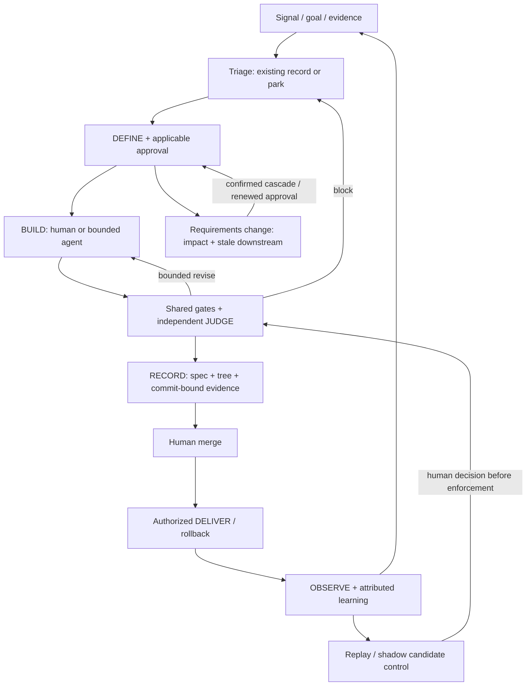

# ADR-007: Evidence-driven closed loop

## Status
Proposed

## Date
2026-11-07, revised 2026-11-10 (renumbered from a draft that used ADR-003 and clashed with [ADR-003 sandbox backends](ADR-003-sandbox-backends.md))

## Context
The harness already has a lifecycle, Change-Class policy, independent judging, verdict fingerprints, receipts and delivery controls. The question is how to evolve that system, not whether to install a second factory. A task may pass checks and then become stale when requirements change. It may also fail after deployment without that outcome feeding back into the controls that approved it. Adding more agents or more prose does not close those gaps.

This ADR complements [ADR-002](ADR-002-change-class-ladder.md). It does not replace it. Implementation sequencing lives in the [delegation-contracts qualification plan](../research/2026-11-delegation-contracts-qualification-plan.md). Saving or merging this document does not adopt the work, authorize implementation, or approve any merge.

**Evidence boundary.** The companion plan's baseline was verified on 7 Nov 2026 at 16:17, Europe/Madrid (CET), through narrow read-only GitHub metadata and documentation. Main was `6f29275fb76fd82161192f0b54a931249518753d`, VERSION `0.30.0`. Pull requests [#48](https://github.com/soyPeter/agentic-harness/pull/48) and [#54](https://github.com/soyPeter/agentic-harness/pull/54) were merged. [#56](https://github.com/soyPeter/agentic-harness/pull/56) enforcement fixes and [#52](https://github.com/soyPeter/agentic-harness/pull/52) labels and deliverer changes were still open. These are historical snapshot facts, not a current status check. README promises were not independently executed. Open-PR defect reports are author claims awaiting review. Branch metadata showed protection and checks off, but effective forge rules were not fully audited.

### Forces

- Reuse working controls and reconcile pending fixes before expanding policy or autonomy.
- Acceptance depends on observable behavior and valid evidence, not the builder's summary or a quality score.
- Requirements change. Traceability must identify affected artifacts without rebuilding unrelated work at random.
- Runtime outcomes must inform control quality without treating correlation as causation.
- Preserve a lightweight docs and refactor lane, existing project conventions, and tool and model portability.
- Every layer costs context, execution, review and maintenance. Benefits must be shown on representative tasks.
- Permissions and enforcement must survive untrusted inputs and failures. Planning access does not imply production access.

## Decision
Extend the existing DEFINE, BUILD, JUDGE, RECORD and DELIVER lifecycle into a source-independent, evidence-driven closed loop, with explicit invalidation when requirements change. Add only capabilities that an audit shows are missing. Authority stays in deterministic controls and human decisions. Model reasoning may propose and interpret. It cannot confer permission.

### Invariants

1. **Human PR merge remains mandatory for this architecture.** Existing eligible low-risk spec policy approval is not merge or deploy authority. ADR-002 class and escalation rules remain. Malformed or ambiguous classifications fail closed under the agreed policy.
2. **Independent JUDGE.** Separate the builder and reviewer context. The judge consumes requirements, the diff and executable evidence. The same minimum CI and security guarantees apply to human-authored and agent-authored changes, with risk-appropriate depth. A documentation change does not require browser QA.
3. **Evidence binds what was tested to what is delivered.** Use the spec revision plus the tested tree or code fingerprint before commit. Bind the committed SHA by content equivalence or by rerunning the affected checks. Never invent a future SHA. Keep the command, result or exit status, environment or fixture reference, acceptance-criterion coverage, and explicit unknown or unverified areas. Receipts are evidence references, not approval tokens.
4. **Truthful states.** Passing is not independently accepted. Independently accepted is not merged. Merged is not deployed. Deployed is not enabled for a client. Enabled is not an observed outcome. Risk labels and numerical scores cannot promote those states.
5. **One operating model.** For Triple, Linear remains the work and decision record, and Monday remains the single status report. There is no parallel agent backlog, extra recurring meeting, or duplicative product-state file. Other projects use an explicit adapter. They are not forced onto Linear.
6. **Bounded action.** Repair and review loops have explicit limits and a destination: repair, review, escalate, park or reject. Limits reuse existing policy or require approval. This ADR does not invent a retry budget. Worktrees alone do not establish runtime isolation. Verify ports, database or schema, environment, credentials and integration before increasing parallelism.

### Interfaces and semantics

**SIGNAL / TRIAGE.** Input is a candidate signal with a source reference, a goal, client scope if relevant, an existing item or deduplication key, evidence, and an accountable role or assignee. Output is an existing work item with a proceed, park, reject or escalate decision, a reason, and a next action. A signal is not authority to build. Incident escalation stays outside normal backlog waiting.

**DEFINE / change impact.** Keep PRD to RFC to CHNG / ADR links where they apply, plus REQ and AC identifiers and Change-Class. Add only missing assumptions (an id, the impact if wrong, and validation evidence or state) and bounded ownership or dependency references. Requirements quality is reviewed. A heuristic clarity score is not a calibrated probability or an approval. A change to an acceptance criterion, constraint, assumption, architecture or risk boundary triggers downstream impact analysis. Mark affected design, tasks, checks, verdicts, receipts and applicable approvals stale. Surface unknown dependencies conservatively. Preview impact and obtain confirmation before cascading edits. Renew required approval. Preserve immutable history. Do not rewrite a prior accepted decision. Unaffected evidence is reusable only when its independence is demonstrated.

**RECORD / feedback.** OBSERVE accepts authorized rollout, behavior or incident evidence linked to a revision, client and environment, and then to a PR, change or spec. Attribution is confirmed, suspected or unknown, with its evidence. It emits one owned, deduplicated learning action, not automatic code changes. That action may add a regression case, propose a control change, or explicitly park the finding. Policy candidates are evaluated on replay before human-approved enforcement.

### Policy rollout

Keep report-only or shadow mode separate from enforcement. Shadow candidates cannot change approvals, trigger merges, launch production repairs or bypass mandatory security gates. Replay uses resettable representative fixtures, a pinned model, harness and environment, and an evaluator whose expected outcomes are independent of the builder. Track false blocks, missed defects and infrastructure failures separately. Compare one variable at a time. Keep existing required controls while evaluating feedback frequency or optional orchestration. A model upgrade triggers a review of layer value. It does not automatically delete safety boundaries.

### Adoption criteria

The companion plan owns implementation sequencing, not this ADR. **P0** refreshes the baseline and independently reconciles #56 and #52 plus existing thin-mode work. **P1** audits and extends invalidation, contracts and receipt binding. **P2** introduces provenance adapters and replay or shadow. **P3** considers parallelism only after verified isolation and a demonstrated bottleneck. Existing implementation found by audit is tested and reused, not rebuilt. Repository edits, agents and merges require separate authorization.

Before declaring adoption, produce reproducible evidence that:

- A change to an acceptance criterion, risk or assumption cannot reuse an affected approval or receipt, and unrelated evidence is retained only with a demonstrated independent dependency.
- Precommit fingerprints and committed artifacts bind truthfully. Code or spec changes stale affected evidence. Failed or absent execution cannot appear as passing.
- Invalid, hidden or conflicting classes, and rename or deletion paths, cannot evade applicable gates. Legacy artifacts fail safely without losing history.
- Human-authored and agent-authored equivalent changes face the same minimum gates. The builder cannot approve its own result, weaken expectations unnoticed, or merge through an alternate tool route.
- A duplicate signal creates no duplicate repair. Parked work remains parked. A production regression links to a PR, or remains explicitly unattributed, and yields one owned next action.
- Replay is resettable and independent, distinguishes infrastructure failure from task failure, records false blocks and missed defects, and cannot let shadow output mutate authority.
- A fresh session resumes from versioned evidence or a checkpoint without the previous chat. Concurrent tasks, if enabled, cannot contaminate runtime state and are checked together at integration.

Record exact revisions, commands, exit status, fixtures, negative cases and independent review. Baseline tests must reproduce the targeted defect where applicable, then pass on the candidate. Run current repository regression checks. This ADR does not adopt an arbitrary coverage percentage, duration, cost improvement or "regret-free" threshold. Acceptance-case completeness and policy rollout criteria still need human agreement.

## Alternatives considered

- **A. Stabilize the current pipeline and add improvements case by case.** Lowest immediate architectural cost. Keeps current controls and existing teams and tools. Viable if incidents and drift remain rare. Cross-artifact staleness and feedback then depend on manual discipline. Policy decisions are harder to reproduce or compare. Keep this as a safe interim while stabilizing. It is not the target once repeated drift is demonstrated.
- **B. Incrementally extend the existing harness with versioned evidence, impact invalidation and feedback interfaces.** Reuses fingerprints, Change-Class, the judge and receipts. Makes claims auditable. Integrates with the current backlog and cadence. Optional expensive layers can be evaluated independently. Needs schema and migration design, attribution discipline, replay fixtures and ongoing maintenance. False invalidation can slow delivery. **This is the decision**, gated by audit, measured need and staged acceptance.
- **C. Adopt an external integrated workflow or framework as the primary lifecycle.** May give faster access to packaged specs, delegation or QA. AgentSpec and runtime QA services illustrate reusable mechanisms. Cost is migration, overlapping sources of truth, a data and security review, and vendor or tool coupling. Published inventories and claims do not show a better fit or outcome here. Defer replacement pending a bounded comparison. Reusable components may be evaluated without transferring governance.

No option removes independent verification or human PR merge. A is not "no quality controls". C is not assumed incapable. B is preferred because it addresses the traceability problem, limits replacement and preserves existing investment. It is not preferred because an end-to-end factory has been proven cheaper or safer for this repository.

## Consequences

- **Easier:** reviewable provenance, less stale-proof risk, explicit unknowns, owned learning destinations, reusable deterministic checks, and optional layer evaluation without a platform replacement. Shared evidence supports existing meetings rather than more reporting.
- **Harder:** dependency metadata can drift. Invalidation may be overbroad or incomplete. Fixtures, schema migrations and independent reviews cost effort. Attribution and sensitive trace handling need discipline. A complete-looking graph is not proof of complete requirements. More recorded evidence can increase storage and privacy exposure. No outcome or ROI improvement is claimed until it is evaluated.
- **Security and rollback.** Least-privilege tool contracts, untrusted-source separation, synthetic or redacted fixtures, no production credentials by default, and controlled access and retention for traces are required design constraints. Exact retention and permissions need project approval. Specs, scripts and agent output cannot override forge or deploy controls. Human-merge enforcement must be checked across CLI and API routes and effective forge rules, not inferred from prose. Changes use versioned additive metadata where possible. Unsupported or unbound evidence is historical or unknown, never silently accepted. Roll back candidate controls to the last reviewed configuration or to report-only mode. Keep raw evidence and mandatory checks. Disable feedback adapters without deleting backlog items or audit history. Serialize execution if isolation fails. Revert source changes through the reviewed normal workflow. Never reset pending worktrees or revive known bypasses just to restore throughput.
- **Unresolved boundaries.** Accepting this ADR, and authorizing P0, stays with the human repository maintainer. The impact schema, dependency scope and legacy migration stay with the workflow maintainer and an independent verification reviewer, after a scoped code audit. Project gates, permission boundaries and forge enforcement stay with a security or reliability reviewer plus the human policy authority, verified against the actual configuration. Attribution, client observation scope and the existing cadence stay with the current product and incident owners. The replay set, thresholds and optional layer removal are proposed by an evaluator independent of the builder, and approved by the human policy authority before enforcement. This record assigns no named person new work. Exact storage schemas, command names, file layouts, budgets and implementation changes are left to audit and design. Revisit the recommendation if the current system already meets these criteria, if representative evaluation shows the added layer is not worth its cost, if migration breaks safety, or if an external component demonstrates a better fit under the same constraints.
- **Non-goals.** Automerge. Unsupervised production repair or deploy. Adopting AgentSpec, Ito or another platform by default. Changing ADR-002 or creating a second approval ladder. Fixed specialist counts or confidence thresholds. New calendar rituals. Importing benchmark metrics as targets. Asserting a compliance certification. This proposal is not a code audit or an approval of any currently open PR.

### Sources

- Companion plan in this repository: [2026-11-delegation-contracts-qualification-plan.md](../research/2026-11-delegation-contracts-qualification-plan.md). Dated baseline, proposed packages and tests. Source for repo-state claims in the original draft.
- [Leiva, 7 Nov 2026](https://devexpert.io/blog/harness-engineering), full article. Sells training and a starter. [Anthropic, long-running harnesses](https://www.anthropic.com/engineering/effective-harnesses-for-long-running-agents), full report, web-app-specific. Multi-agent superiority remains open. [Jain, harness economics](https://martinfowler.com/articles/are-harnesses-worth-the-cost.html), full single-service small-sample experiment. It does not prove ROI here, or that final-only gates were experimentally better.
- [Manish](https://medium.com/@manishmshiva/the-agentic-sdlc-how-ai-is-transforming-software-development-b6bed6d3991d) and [Lorenzo](https://medium.com/@lorenzouriel/my-workflow-with-claude-spec-driven-development-with-agentspec-82e9003f8445). [AgentSpec ITERATE primary](https://github.com/luanmorenommaciel/agentspec/blob/e00f832c4d9949572c17d57621a3fd7f28ca2400/.claude/skills/sdd-iterate/SKILL.md): cascade and versioning mechanism. Inventories and static confidence categories are not calibrated benefit evidence.
- [Eno Reyes](https://x.com/EnoReyes/status/2118767454721851680), Factory CTO, full post and diagram. [Tan](https://x.com/poteto/status/2118613050462728659), deterministic-engineering counterpoint. [Uber](https://www.uber.com/us/en/blog/securing-ai-agents/), intent, provenance and replay. Vendor or internal-platform experience informs design. It is not proof that this proposal works.

Supporting notes also exist in the private knowledge-base repository. They are not linked from this file, because those paths do not resolve in this repository.
