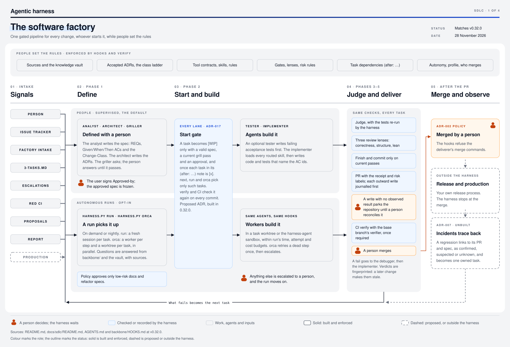
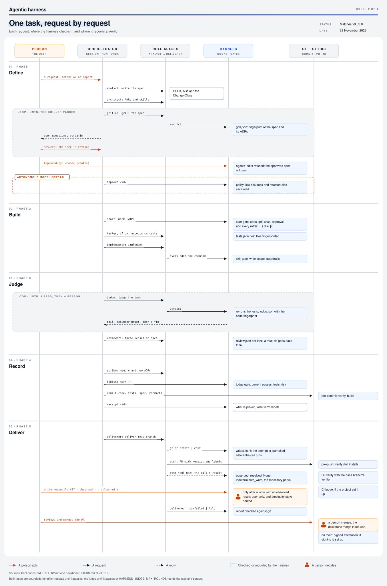
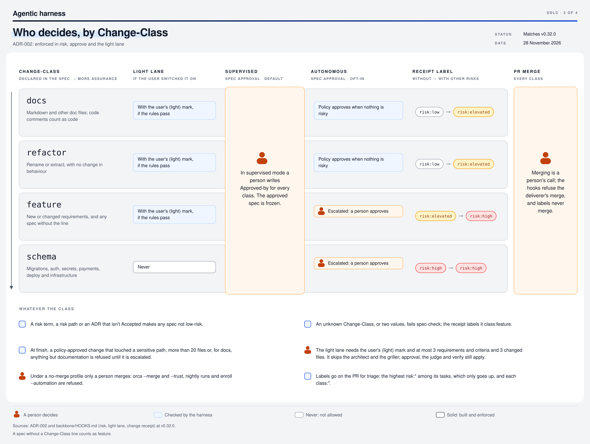
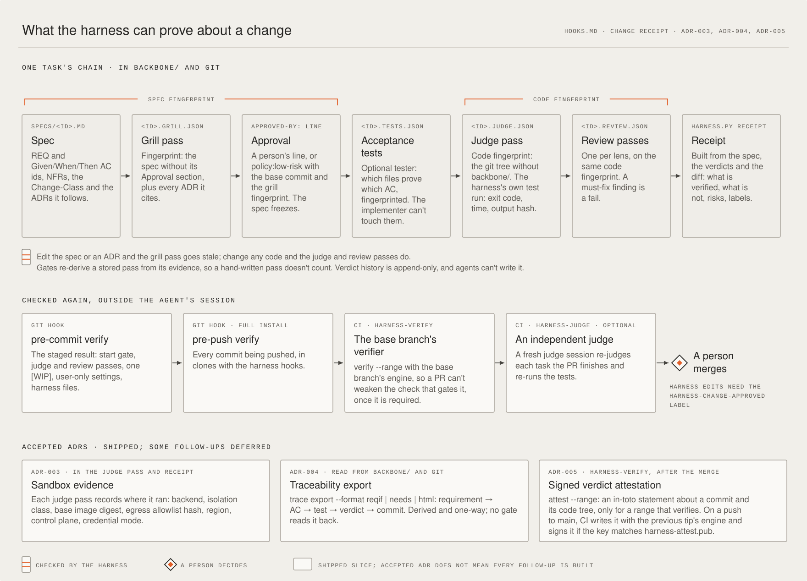

# The software factory, in four diagrams

How a change moves through the agentic harness, from the first signal to a merged pull request. The layout follows
[Eno Reyes's software-factory diagram](https://x.com/EnoReyes/status/2118767454721851680) (November 2026): one process
for every change, whoever or whatever starts it, with people setting the rules.

Solid shapes show shipped harness mechanisms; enforcement depends on the project's enabled gates and required CI
checks. Dashed ones show unbuilt behavior or behavior outside the harness. ADR acceptance and implementation
status are separate. The orange person marks each point where the harness waits for a human. Colour marks the role:
blue is what the harness checks or records, grey the work, agents and inputs, white a record in `backbone/` or git,
and orange a person.

[ADR-008](../adr/ADR-008-harness-inside-agent-factory.md) (Accepted, revised 13 November 2026) places this process
inside each lane of the agent software factory. The supplied [factory snapshot](sources/agent-software-factory-2026-11-13.png)
reports `sixseven` / `67` live on `claude-box` since 11 November. That is the image's report, not an audit of the
service or proof that the harness integration has shipped. The four views below describe the harness workflow;
the factory adds intake, conversation, execution lanes and operations around it.

## Where the factory meets this SDLC

The image's worker loop is **Pick → Build → Open PR → You review → Close out**. Our integrated path adds DEFINE
and independent acceptance checks inside that loop:

| Factory stage or service | Harness requirement inside the lane | Current boundary |
|---|---|---|
| Slack / GitHub / Linear → inbox | Record the source and trusted-sender verdict, deduplicate intake, draft the spec | Factory reports its inbox live; harness provenance intake is implemented in PR #90, with factory adapter unverified |
| Pick | Analyst, architect, griller and spec approval before Build | Delegation, roster `go` and `agent-ok` select work; they do not replace required spec approval |
| Build and advisor | Implementer/optional tester, then independent judge and correctness/structure/lean reviews | Fable advises on features and wide changes; it no longer challenges every diff and cannot substitute for those reviews |
| Risk-triggered security | Additional security review must pass when required | Image reports no Mythos key; flagged work stops, with no silent downgrade |
| Open PR | Receipt, exact-revision verification, trusted delivery and required base-verifier CI | Harness delivery plan/record implemented in PR #90; factory adapter unverified; a prior PR does not prove an edit succeeded |
| You review | Trusted feedback returns as findings; changes invalidate affected verdicts and the same PR is updated | Factory reports same-session revisions; harness feedback adapter remains a follow-up |
| Close out and memory | Scribe records memory/Proposed ADRs before finish; KB drafts enter a human-reviewed PR | Facts remain hearsay until proposed; the image says KB push is off pending branch protection |
| Runtime and cleanup | Read task state, evidence and safe lifecycle signals | Listener, dispatcher, lanes, watchdog and janitor belong to the factory; preview stack, ongoing QA and parallel workers per project are not built in the image |

**Identity and merge.** The factory currently uses Andrei's GitHub/Linear credentials, and its Front can merge
after a roster request and GitHub approval. The harness integration requires a separate factory identity that
cannot merge, approve its own PR or bypass protection. A roster request does not establish that boundary. Human
spec approval and human merge remain required under the existing Change-Class and delivery rules.

**Budgets.** The image lists $25/task, $100/day and $5/conversation, plus a separate Front chat budget of $25/day.
Only advisor calls pass through its key proxy; workers use a subscription. Qualify worker/Front limits separately
before claiming those caps cover the whole factory. The harness's current per-run cost check happens between
tasks; PR #90 adds per-task accounting across resumes as defence in depth, with unreported prices remaining a gap.

**Evidence and recovery.** Factory test reruns should feed the harness's revision-bound receipt and required CI.
Keep sender authorization, spec approval, test evidence and merge authority distinct.
[ADR-011](../adr/ADR-011-indeterminate-side-effect-outcomes.md) (Proposed) requires durable write attempts and
reconciliation after lost replies. Its journal and reconcile-or-park shipped in 0.32.0: the user reconciles each write
that had no observed result with `harness.py write-reconcile`. Automatic, operation-specific reconciliation is not
built.

The integration order is DEFINE/approval and independent acceptance checks, dedicated identity and trusted
delivery, then feedback, KB drafts and cleanup signals. ADR-008 retains the contract, failure cases and follow-ups.

## 1. The factory at a glance

- **People set the rules.** Only the user accepts an ADR, writes the tool contracts in `tools.conf`, admits or
  revokes third-party skills in `admissions.conf`, or changes the user-only keys of `harness.conf`: the gate switches,
  risk rules, autonomy mode and profile. Hooks refuse agents' edits to them, and verify refuses commits that change the
  user-only settings, contracts or admissions. Skill routes and guardrails come from the packs an accepted ADR adopts
  and the rules agreed at setup.
- **Signals.** Work comes from a person, an issue-tracker ticket (Linear: `harness.py linear import`), a factory's
  request (`harness.py intake`) or the task list. The harness's
  own feedback adds more: escalations, red CI, failure-class proposals and `harness.py report` candidates. Production
  incidents are not a signal yet.
- **Two lanes, one standard.** In a supervised session (the default), a person answers the griller and signs
  `Approved-by`. In an autonomous run (`harness.py run`, `harness.py orca`), questions are answered from `backbone/`
  and the knowledge vault, with sources. Policy approves only low-risk `docs` and `refactor` specs, and everything
  else is escalated to a person.
- **One start gate.** In either lane a task becomes `[WIP]` only with a valid spec, a current grill pass and an
  approval, and once every task its `(after: ...)` note names is `[x]`; `next`, `run` and Orca pick only such tasks,
  and verify checks it again ([ADR-017](../adr/ADR-017-task-dependency-gate.md): Proposed, and built since 0.32.0).
- **Same checks, every task.** Whichever lane a task came from, it passes the same checks:
  - the judge, with the harness re-running the tests itself;
  - the three review lenses;
  - the judge gate at finish;
  - verify on every commit;
  - the pull request written only after the harness journals it (section 2);
  - `harness-verify` in CI, with the base branch's verifier.

  Then a person merges the pull request. A judge pass still leaves deploy risk open. That person reads the review notes and the receipt's "Not verified" list first. The hooks refuse the deliverer's merge commands, and under a no-merge profile (`triple` or `no-merge`) every agent's;
  `harness-verify` blocks a merge only once it is a required check in branch protection (`harness.py ci-protect` or
  `enroll.sh --protect`).
- **What fails becomes the next task.**
  - Red CI becomes a fix task on the same pull request.
  - Escalations wait for a person.
  - A failure class seen twice opens a proposal.
  - The report points at missing rules or skills.

  Tracing a production incident back to its pull request and spec is drawn dashed: it is accepted in
  [ADR-007](../adr/ADR-007-evidence-closed-loop.md), but not built. Shared harness triage before Define (deduplicate,
  set an owner, pick a lane or park) is not a complete harness stage. PR #90 implements provenance intake and
  deduplication, but the factory's deployed adapter and broader triage remain unverified.

## 2. One task, request by request

Read it top to bottom. Each arrow is a request, and each box on a lifeline is where the harness checks or records
something. Both loops are bounded: the griller repeats until it passes, and the judge until it passes or
`HARNESS_JUDGE_MAX_ROUNDS` hands the task to a person. The dashed orange frame is the one step autonomous mode replaces:
`harness.py approve` instead of a person's `Approved-by`, and only for low-risk `docs` and `refactor` specs.

- **Definition first**: one spec per task (`backbone/specs/<id>.md`) holds numbered requirements, Given/When/Then
  acceptance criteria, NFRs, the `Change-Class`, the ADRs it follows and the skills it needs. A PRD is optional; ADRs
  are mandatory.
- **Grilling**: an adversarial `griller` agent questions the spec and its ADRs. Its questions go to the user, the spec
  is revised, and grilling repeats until it passes. Then the **user** approves the spec. Only the user can write the
  approval line, and an approved spec is frozen. For small fixes, the user can switch on a **light lane** and mark a
  task `(light)`: a small, low-risk spec then skips the architect and the griller, while the approval, the judge and
  verify still apply.
- **Skill routing**: `routing.conf` maps paths to skills. ADRs need `adr-writing`, `architecture` and the language
  skill; controllers need `api-design` and `openapi`; and so on. The spec adds what the task needs. An agent can't edit
  a file until it has loaded every required skill in its session.
- **Tool contracts**: every tool that can change something goes through the gate. A user-owned `backbone/tools.conf`
  says what each MCP or other tool does (read, write with its path field, exec, network, agent, and whether it needs
  the user); a write tool's paths get the same gates as Write and Edit. In supervised mode a tool with no contract runs
  with a warning; in autonomous mode it is refused.
- **Third-party skills** ([ADR-006](../adr/ADR-006-external-agent-resource-admission.md), Accepted): a vendor's
  setup prompt, skill or plugin is reference until the user admits a reviewed copy in `backbone/admissions.conf`, with
  its decision, source, revision, digest, purpose, compatibility, dependencies, data destinations and license. Changed
  bytes lose the admission until the user reviews them again, a revoked bundle stays blocked (a rollback can't bring
  it back), and admission grants no tool or permission. Agents can't invoke a skill that runs commands as it loads.
- **Guardrails** throughout: destructive commands, secrets and project rules are blocked. Each agent can only write
  its own files, and the main session only orchestrates. Shell commands can't write harness state or switch off
  checks, and a script that does is caught: reported in supervised mode, escalated in autonomous mode. Nothing writes
  inside `.git` (where the event log and cost ledgers live), no interpreter runs a program from stdin, and the
  user-only commands can't be started by another spelling. One task is `[WIP]` at a time. Commits follow Conventional
  Commits. The gates are on by default and only the user can switch them off.
- **Judging**: an independent `judge` checks every requirement and acceptance criterion against the code and tests.
  The verdict is recorded by a hook, which re-derives it from the evidence: an AC without a test that mentions its id,
  unmet criteria or failing tests all turn a claimed pass into a fail. The recorder runs the test command itself rather
  than trusting the judge's report. After a fail, the `debugger` writes a fix brief for whoever owns the cause.
- **Review and delivery**: after the judge, three `reviewer`s check the change in parallel, one lens each: correctness
  (bugs, security, blast radius proven by running code), structure and lean. A must-fix finding sends the task back to
  the implementer. Once the task is committed, the `deliverer` pushes the branch, opens the PR with each task's receipt
  and labels, and watches CI. It runs only the gh commands delivery needs, against this repository only; its merge,
  approve and close commands are refused, and its git ref commands (checkout, merge, reset, push and the like) may not
  name the default branch, which changes only through the PR. Before a pull request is created or edited, the harness
  journals the attempt (`writes.jsonl`), and it resolves the attempt once the agent CLI reports the call succeeded. A
  write with no observed result is `indeterminate_write`: nothing retries it, and the repository parks until the user
  reconciles it with `harness.py write-reconcile` ([ADR-011](../adr/ADR-011-indeterminate-side-effect-outcomes.md):
  Proposed, and built since 0.32.0). Finishing, committing and pushing (pre-push hook) all refuse a task
  without its review passes. Both are on by default (`HARNESS_REVIEW`, `HARNESS_DELIVER`, user-only).
  `HARNESS_DELIVER="external"` is for a lane without GitHub credentials: the task stops at the deliver step,
  `delivery-plan` tells an agent factory what to push and open from its trusted clone, and `delivery-record` records
  the outcome, checked against the trusted clone's `verify --range` and signed when the factory's environment holds
  `HARNESS_DELIVERY_KEY`, so a line an agent appends can't mark a task delivered. In external mode no role can push:
  every agent's git and gh calls are limited to reads.

## 3. Who decides, by Change-Class

- **The ladder** ([ADR-002](../adr/ADR-002-change-class-ladder.md)). The spec declares its `Change-Class`: `docs`,
  `refactor`, `feature` or `schema`; a spec without the line counts as `feature`. The class changes three things:
  whether the light lane applies, whether autonomous mode may approve the spec by policy, and which risk label the
  receipt suggests: `risk:low` (`docs`, `refactor`), `risk:elevated` (`feature`, or `docs`/`refactor` with other risks)
  or `risk:high` (`schema`, or `feature` with other risks). Whatever the class, a person approves every spec in
  supervised mode and merges the pull request.
- **The sandbox each class needs** ([ADR-003](../adr/ADR-003-sandbox-backends.md), user-only
  `HARNESS_SANDBOX_REQUIRE`; the default, `auto`, asks a container for `schema` work in autonomous mode only): such
  work starts only in a session running in that sandbox,
  and finishes only with a judge pass recorded in one, which `verify` and CI check from the recorded evidence. A
  requirement covers the classes above it too, and anything the harness can't read or doesn't know counts as no
  isolation.
- **Autonomous mode** (opt-in, user-only): no human in the loop. The harness approves low-risk specs by policy, from
  the spec and later the diff; only a `docs` or `refactor` spec can be low-risk, so `feature` and `schema` work always
  waits for the user's approval. Everything else, including repeated griller or judge failures, is escalated: the task
  is parked as BLOCKED, an entry goes into `backbone/escalations.md` (optionally a GitHub issue), and work continues. A
  kill switch halts everything.

## 4. What the harness can prove about a change

The receipt is built from evidence, not from what the agents said. Two fingerprints tie each verdict to what it judged,
so an edit after a pass makes that pass stale. The middle row is where the same evidence is checked again outside
the agent's session. The CI floor runs the base branch's verifier, so a pull request can't weaken the check that gates
it. The bottom row shows shipped first slices of three accepted ADRs: sandbox evidence, traceability export and
signed verdict attestations. Their acceptance does not make every follow-up shipped, qualify a factory lane's
isolation or guarantee that signing is configured.

The fingerprints are the spec and its ADRs for the grill pass, and the code tree and that same spec fingerprint for
the judge, review and tester records. Any change to the spec other than its `Approved-by:` lines, or to an ADR it
references, sends the task back to the griller and the judge even when the code is the same, and finishing needs the
user's approval of the changed spec ([ADR-007](../adr/ADR-007-evidence-closed-loop.md), Accepted).

- **Change receipt**: `harness.py receipt <id>` states what the harness can prove about a judged task: what changed,
  each acceptance criterion with its tests, what is *not* verified, the decisions and risks, and what still needs the
  user. It is built from the spec, the verdicts and the diff, and goes into the pull requests the runner and the Orca
  coordinator open. It shows the sandbox the judge pass was recorded in (backend, isolation class, base image digest,
  allowlist hash, region, control plane, credential mode; [ADR-003](../adr/ADR-003-sandbox-backends.md), Accepted),
  so a run that wasn't isolated shows it, and whether that met the sandbox the task's Change-Class needs. It also
  suggests pull request labels for triage: one `risk:*` label and
  `class:<class>`. The deliverer applies them; a label never approves or merges.
- **Verify**: the pre-commit hook re-checks the gates on the staged state, the pre-push hook (full installs) the
  commits being pushed, and CI the pull request's commits (`harness.py verify --range`) with the **base branch's**
  verifier, so a pull request can't weaken the check that gates it, and a change made any other way is still caught.
- **Traceability export** ([ADR-004](../adr/ADR-004-traceability-export.md), Accepted): `harness.py trace export
  --format reqif|reqifz|needs|html [--out DIR] [--task ID]` writes the chain requirement → acceptance criterion → test
  file → judge verdict → commit as ReqIF 1.2 (results and verdicts as enumerations), a ReqIF archive with each task's
  receipt, a Sphinx-Needs `needs.json` (format 1) or a self-contained HTML matrix. It is derived from `backbone/` and
  git, which stay the record: one-way, no network, nothing reads it back. Each task says whether its judge pass is on
  the current code, which commits carry the judged code, and the gaps it can see. `harness-verify` uploads the matrix
  of each pull request that verifies, written by the base branch's engine, and the deliverer links it from the pull
  request (`harness.py trace link`); with ADR-005 signing, the push job signs a `.reqifz`. It is not validated or PCI
  DSS evidence; the ADR lists what it can and can't support.
- **Signed verdict attestations** (optional, [ADR-005](../adr/ADR-005-verdict-attestations.md), Accepted):
  `harness.py attest --range <base>..<tip>` prints an in-toto Statement (predicate `verdicts/v1`) about the tip commit
  with each finished task's verdict chain (spec fingerprint, grill, judge and review verdicts, Change-Class, risk and
  receipt), only for a range that passes `verify --range`, and the same bytes for the same commits. On each push to the
  default branch, the `attest` job of `harness-verify` writes it with the engine the push starts from (the previous
  tip, never the pushed one) and signs it with cosign in the `harness-attest` environment: with a key
  (`HARNESS_ATTEST_KEY`, `HARNESS_ATTEST_PASSWORD`) by default and without a transparency log, with a cloud KMS key, or,
  only when `harness.conf` opts in, keyless on Sigstore's public log. The key must match the public key committed as
  `harness-attest.pub`, an enforcement file like the harness's own. A harness change is attested when a pull request
  labelled `harness-change-approved` made the push, and the statement names it. `harness.py ci-protect --attest` sets
  up the environment, restricted to the default branch; `harness.py attest verify` checks a signed statement and a
  policy on it. Pull requests never see the key, and the statement claims no SLSA level. Details and limits in
  `backbone/HOOKS.md`.
- **What binds whom**: the hooks and gates bind agents. The user can still switch a gate off in `harness.conf` or
  commit with `HARNESS_VERIFY=off`; CI's `harness-verify` is what binds everyone, once it is required.
- **Safe updates**: harness files are tracked by hash. Local edits are detected and never overwritten silently.

## Sources

- [README](../../README.md), and in `payload/owned/`: `AGENTS.md`, `backbone/8-WORKFLOW.md`, `backbone/HOOKS.md`
- [ADR-001](../adr/ADR-001-thin-mode-plugin.md) and [ADR-002](../adr/ADR-002-change-class-ladder.md) are accepted.
  [ADR-003](../adr/ADR-003-sandbox-backends.md), [ADR-004](../adr/ADR-004-traceability-export.md) and
  [ADR-005](../adr/ADR-005-verdict-attestations.md) are Accepted and shipped; each one's "Follow-up status" says which
  follow-ups are done and which are deferred or not run end to end.
- [ADR-008](../adr/ADR-008-harness-inside-agent-factory.md), Accepted: factory/harness ownership and integration contract.
- [Factory image supplied 13 November 2026](sources/agent-software-factory-2026-11-13.png), preserved from
  `~/Downloads/Agent-software-factory.png`; SHA-256
  `25d2b177c64f146c967b39b9229d335ec7cad61528491be123f2e8750078a0a3`. Factory runtime claims above are attributed to
  this snapshot; no factory code, credentials, deployment or forge protection was inspected.
- [Agent-SDLC landscape research](../research/2026-11-agent-sdlc-landscape.md)

## Editing the diagrams

The JSON in [sources/](sources/) is the source of each diagram: `<n>-<name>.diagram.json` holds its cards, arrows and
text, and `theme-neutral.json` its colours and system fonts. The SVGs are rendered from them with the diagram_style
renderer and the neutral theme, for example
`python3 diagram_style.py render sources/1-factory.diagram.json --theme sources/theme-neutral.json --output 1-factory.svg`.
Edit the JSON, never the SVG, and keep the legend's meaning: solid is built and enforced, a dashed outline is proposed
or outside the harness, and the orange person marks where the harness waits for a human. The SVGs carry their own
background, so they read the same in GitHub's light and dark themes. Update a diagram in the same pull request as the
behaviour it shows.
