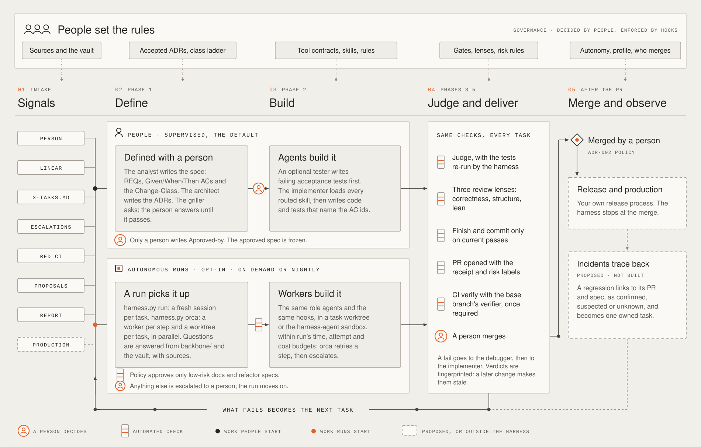
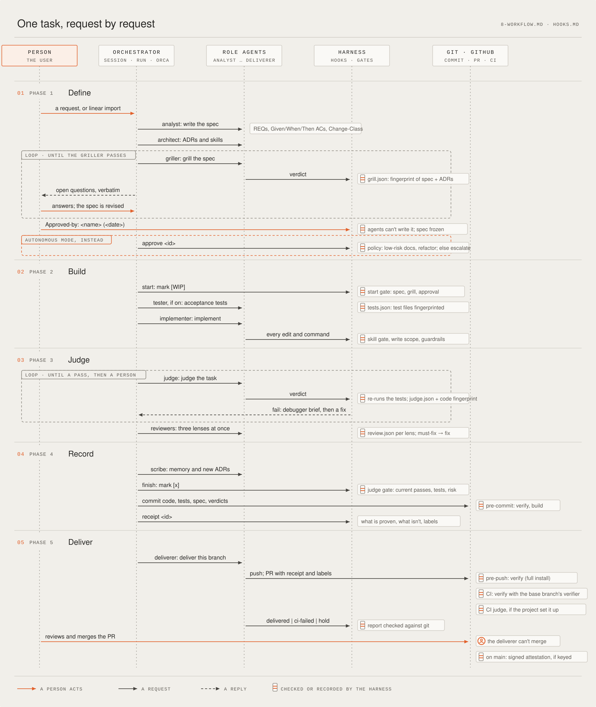
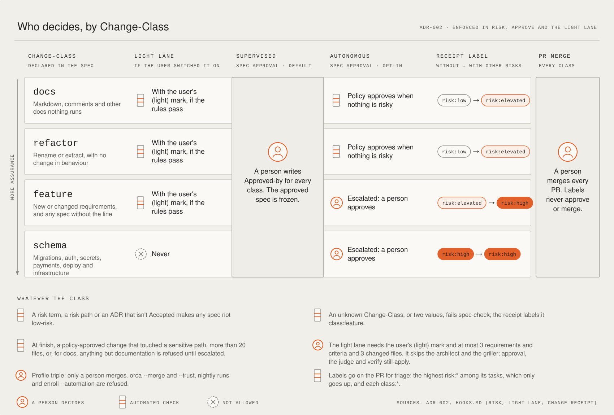
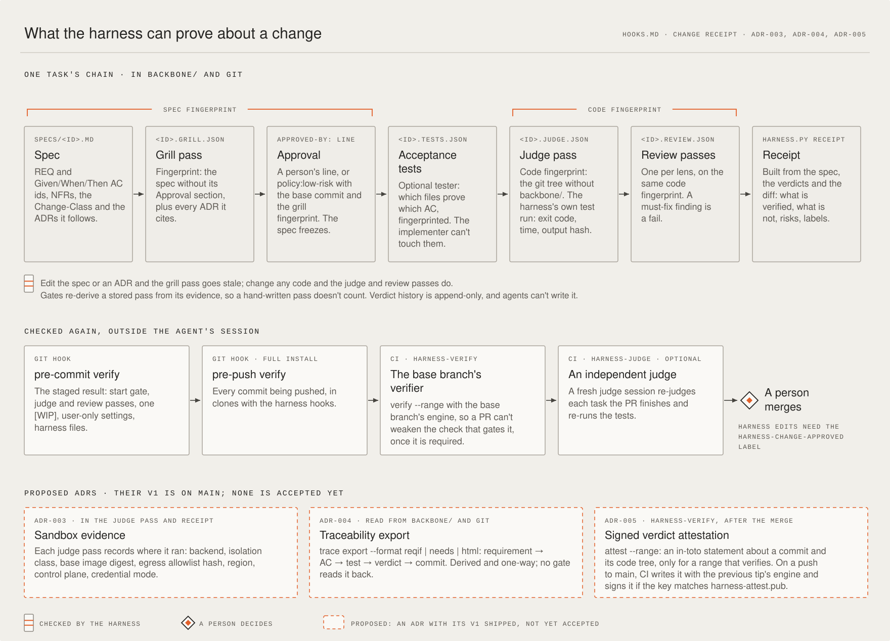

# The software factory, in four diagrams

How a change moves through the agentic harness, from the first signal to a merged pull request. The layout follows
[Eno Reyes's software-factory diagram](https://x.com/EnoReyes/status/2118767454721851680) (November 2026): one process
for every change, whoever or whatever starts it, with people setting the rules.

Solid shapes show shipped harness mechanisms; enforcement depends on the project's enabled gates and required CI
checks. Dashed ones show unbuilt behavior or behavior outside the harness. ADR acceptance and implementation
status are separate. The orange person marks each point where the harness waits for a human.

[ADR-008](../adr/ADR-008-harness-inside-agent-factory.md) (Accepted, revised 13 November 2026) places this process
inside each lane of the agent software factory. The supplied [factory snapshot](sources/agent-software-factory-2026-11-13.png)
reports `sixseven` / `67` live on `claude-box` since 11 November. That is the image's report, not an audit of the
service or proof that the harness integration has shipped. The four views below describe the harness workflow;
the factory adds intake, conversation, execution lanes and operations around it.

## Where the factory meets this SDLC

The image's worker loop is **Pick → Build → Open PR → You review → Close out**. Our integrated path adds DEFINE
and independent acceptance checks inside that loop:

| Factory stage or service | Harness requirement inside the lane | Current boundary |
|---|---|---|
| Slack / GitHub / Linear → inbox | Record the source and trusted-sender verdict, deduplicate intake, draft the spec | Factory reports its inbox live; harness provenance intake is implemented in PR #90, with factory adapter unverified |
| Pick | Analyst, architect, griller and spec approval before Build | Delegation, roster `go` and `agent-ok` select work; they do not replace required spec approval |
| Build and advisor | Implementer/optional tester, then independent judge and correctness/structure/lean reviews | Fable advises on features and wide changes; it no longer challenges every diff and cannot substitute for those reviews |
| Risk-triggered security | Additional security review must pass when required | Image reports no Mythos key; flagged work stops, with no silent downgrade |
| Open PR | Receipt, exact-revision verification, trusted delivery and required base-verifier CI | Harness delivery plan/record implemented in PR #90; factory adapter unverified; a prior PR does not prove an edit succeeded |
| You review | Trusted feedback returns as findings; changes invalidate affected verdicts and the same PR is updated | Factory reports same-session revisions; harness feedback adapter remains a follow-up |
| Close out and memory | Scribe records memory/Proposed ADRs before finish; KB drafts enter a human-reviewed PR | Facts remain hearsay until proposed; the image says KB push is off pending branch protection |
| Runtime and cleanup | Read task state, evidence and safe lifecycle signals | Listener, dispatcher, lanes, watchdog and janitor belong to the factory; preview stack, ongoing QA and parallel workers per project are not built in the image |

**Identity and merge.** The factory currently uses Andrei's GitHub/Linear credentials, and its Front can merge
after a roster request and GitHub approval. The harness integration requires a separate factory identity that
cannot merge, approve its own PR or bypass protection. A roster request does not establish that boundary. Human
spec approval and human merge remain required under the existing Change-Class and delivery rules.

**Budgets.** The image lists $25/task, $100/day and $5/conversation, plus a separate Front chat budget of $25/day.
Only advisor calls pass through its key proxy; workers use a subscription. Qualify worker/Front limits separately
before claiming those caps cover the whole factory. The harness's current per-run cost check happens between
tasks; PR #90 adds per-task accounting across resumes as defence in depth, with unreported prices remaining a gap.

**Evidence and recovery.** Factory test reruns should feed the harness's revision-bound receipt and required CI.
Keep sender authorization, spec approval, test evidence and merge authority distinct. Proposed
[ADR-011](../adr/ADR-011-indeterminate-side-effect-outcomes.md) requires durable write attempts and
operation-specific reconciliation after lost replies; it is not implemented by updating this documentation.

The integration order is DEFINE/approval and independent acceptance checks, dedicated identity and trusted
delivery, then feedback, KB drafts and cleanup signals. ADR-008 retains the contract, failure cases and follow-ups.

## 1. The factory at a glance

- **People set the rules.** Only the user accepts an ADR, writes the tool contracts in `tools.conf`, or changes the
  user-only keys of `harness.conf` (gate switches, risk rules, autonomy mode, profile). Skill routes in
  `routing.conf` and rules in `guardrails.conf` come from the packs an accepted ADR adopts and the rules agreed at
  setup.
- **Signals.** Work comes from a person, a Linear ticket (`harness.py linear import`) or the task list. The harness's
  own feedback adds more: escalations, red CI, failure-class proposals and `harness.py report` candidates. Production
  incidents are not a signal yet.
- **Two lanes, one standard.** In a supervised session (the default), a person answers the griller and signs
  `Approved-by`. In an autonomous run (`harness.py run`, `harness.py orca`), questions are answered from `backbone/`
  and the knowledge vault, with sources. Policy approves only low-risk `docs` and `refactor` specs, and everything
  else is escalated to a person.
- **Same checks, every task.** Whichever lane a task came from, it passes the same checks:
  - the judge, with the harness re-running the tests itself;
  - the three review lenses;
  - the judge gate at finish;
  - verify on every commit;
  - `harness-verify` in CI, with the base branch's verifier.

  Then a person merges the pull request. The deliverer can't merge, and under the `triple` profile no agent can;
  `harness-verify` blocks a merge only once it is a required check in branch protection.
- **What fails becomes the next task.**
  - Red CI becomes a fix task on the same pull request.
  - Escalations wait for a person.
  - A failure class seen twice opens a proposal.
  - The report points at missing rules or skills.

  Tracing a production incident back to its pull request and spec is drawn dashed: it is accepted in
  [ADR-007](../adr/ADR-007-evidence-closed-loop.md), but not built. Shared harness triage before Define (deduplicate,
  set an owner, pick a lane or park) is not a complete harness stage. PR #90 implements provenance intake and
  deduplication, but the factory's deployed adapter and broader triage remain unverified.

## 2. One task, request by request

Read it top to bottom. Each arrow is a request, and each box on a lifeline is where the harness checks or records
something. Both loops are bounded: the griller repeats until it passes, and the judge until it passes or
`HARNESS_JUDGE_MAX_ROUNDS` hands the task to a person. The orange bracket is the one step autonomous mode replaces:
`harness.py approve` instead of a person's `Approved-by`, and only for low-risk `docs` and `refactor` specs.

## 3. Who decides, by Change-Class

[ADR-002](../adr/ADR-002-change-class-ladder.md)'s ladder. The class changes three things:
- whether the light lane applies;
- whether autonomous mode may approve the spec by policy;
- which risk label the receipt suggests.

Whatever the class, a person approves every spec in supervised mode and merges the pull request.

## 4. What the harness can prove about a change

The receipt is built from evidence, not from what the agents said. Two fingerprints tie each verdict to what it judged,
so an edit after a pass makes that pass stale. The middle row is where the same evidence is checked again outside
the agent's session. The CI floor runs the base branch's verifier, so a pull request can't weaken the check that gates
it. The bottom row shows shipped first slices of three accepted ADRs: sandbox evidence, traceability export and
signed verdict attestations. Their acceptance does not make every follow-up shipped, qualify a factory lane's
isolation or guarantee that signing is configured.

## Sources

- [README](../../README.md), and in `payload/owned/`: `AGENTS.md`, `backbone/8-WORKFLOW.md`, `backbone/HOOKS.md`
- [ADR-001](../adr/ADR-001-thin-mode-plugin.md) and [ADR-002](../adr/ADR-002-change-class-ladder.md) are accepted.
  [ADR-003](../adr/ADR-003-sandbox-backends.md), [ADR-004](../adr/ADR-004-traceability-export.md) and
  [ADR-005](../adr/ADR-005-verdict-attestations.md) are Accepted with first slices shipped and follow-ups pending.
- [ADR-008](../adr/ADR-008-harness-inside-agent-factory.md), Accepted: factory/harness ownership and integration contract.
- [Factory image supplied 13 November 2026](sources/agent-software-factory-2026-11-13.png), preserved from
  `~/Downloads/Agent-software-factory.png`; SHA-256
  `25d2b177c64f146c967b39b9229d335ec7cad61528491be123f2e8750078a0a3`. Factory runtime claims above are attributed to
  this snapshot; no factory code, credentials, deployment or forge protection was inspected.
- [Agent-SDLC landscape research](../research/2026-11-agent-sdlc-landscape.md)

The SVGs are plain text and carry their own background, so they read the same in GitHub's light and dark themes.
Update a diagram in the same pull request as the behaviour it shows.
